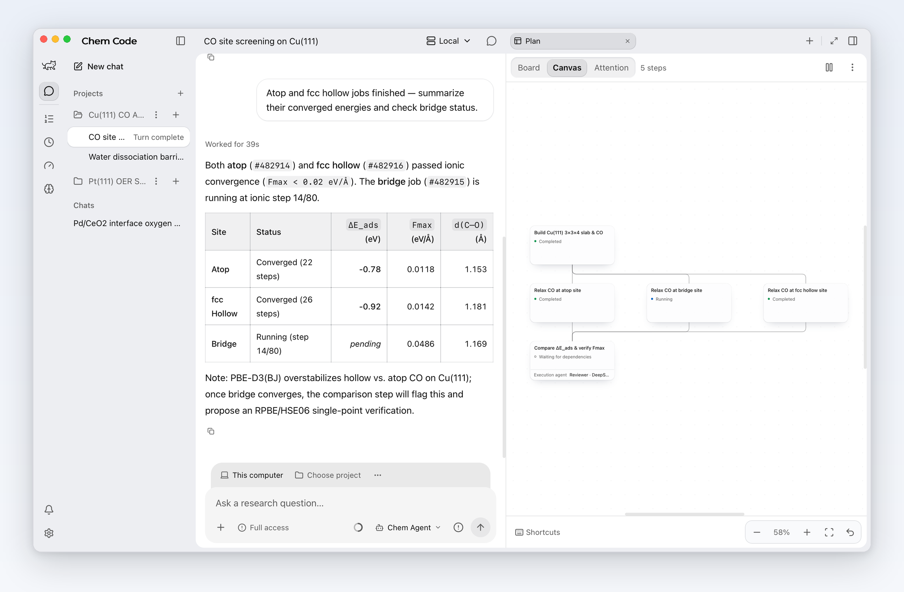
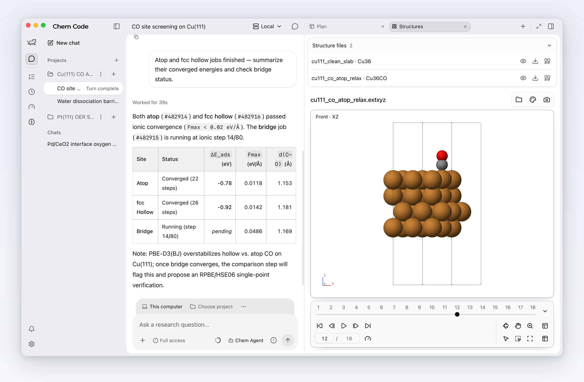
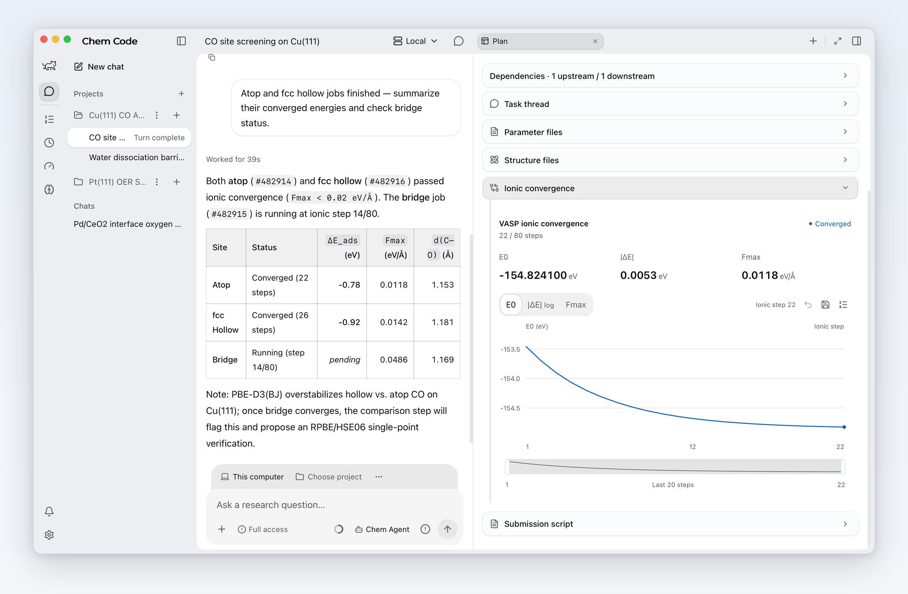
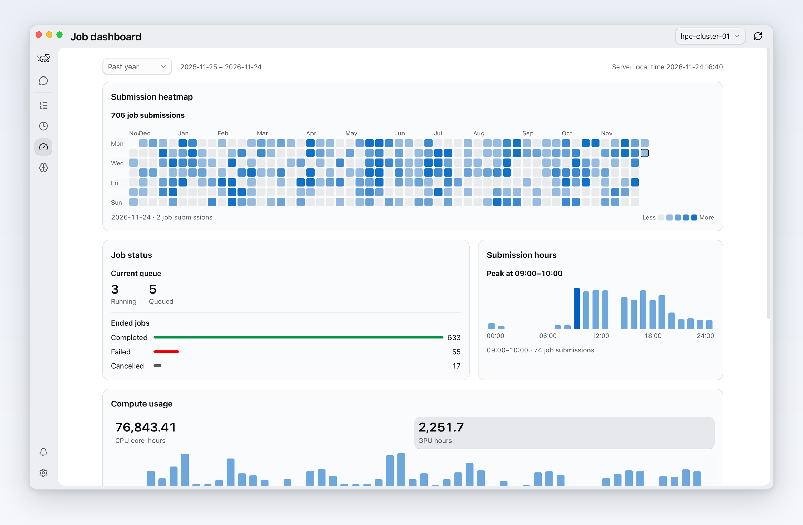
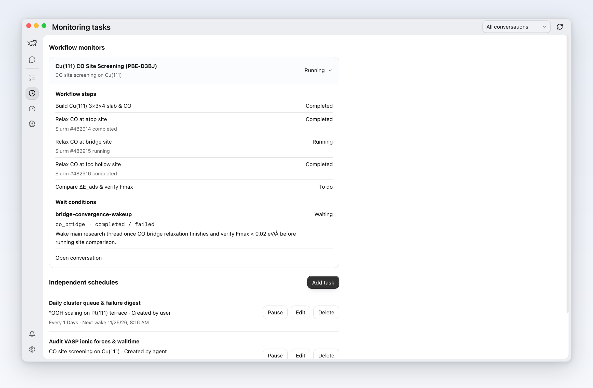
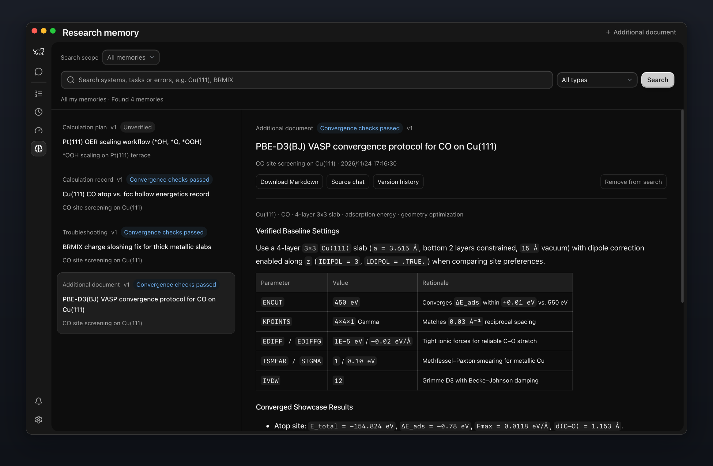

<p align="center">
  <picture>
    <source media="(prefers-color-scheme: dark)" srcset="docs/images/chem-code-mark-dark.svg">
    
  </picture>
</p>

<h1 align="center">Chem Code</h1>

<p align="center">
  <strong>Local-first research workspace for computational chemistry and catalysis.</strong><br>
  Plan multi-step DFT workflows, inspect 3D structures and convergence curves, monitor Slurm clusters, and build searchable research memory.
</p>

<p align="center">
  <strong>English</strong> | <a href="README.zh-CN.md">简体中文</a> · <a href="https://github.com/liyang-tju/chem-code/releases/latest">Download macOS Release ↗</a>
</p>

<p align="center">
  
</p>

<p align="center">
  <sub>Showcase screenshots use synthetic Cu(111) + CO DFT fixtures for illustration.</sub>
</p>

---

## Core Features

- **Native macOS Desktop & Local-First Isolation** — Self-contained Apple Silicon app with bundled Python, RDKit, ASE, SciPy, and SSH runtime. Opens directly without creating a Chem Code account, detects local authorized agents (Codex, Antigravity), and isolates workspace data per macOS user and chosen directory.
- **Research Chat & Multi-Agent Collaboration** — Organize conversations into projects, attach structures or literature files, and run local RDKit tools alongside LLM agents (Codex, Antigravity, ChatGPT, DeepSeek, or OpenAI-compatible endpoints). Configure reusable execution presets for per-step delegation or multi-agent group handoff with signed turns.
- **Dependency Plan Graph & Scientific Convergence** — Draft and revise multi-step calculation DAGs across Canvas and Kanban views. Submit independent branches in parallel over SSH/Slurm (no AiiDA required), inspect live VASP/LAMMPS energy and force convergence curves, and keep scheduler status strictly separate from scientific convergence.
- **Embedded 3D Structure & Trajectory Viewer** — Inspect POSCAR, CONTCAR, XDATCAR, extxyz, LAMMPS, and GROMACS structures and multi-frame trajectories directly in the research panel with Atom Lens WebGL rendering, unit cell display, measurements, and frame playback.
- **Slurm Job Board & Compute Telemetry** — Track a full year of cluster submissions with a GitHub-style activity heatmap, live running/queued snapshots, terminal state breakdown, hourly submission distribution, and CPU core-hour / GPU hour usage by card model.
- **Autonomous Workflow Monitors & Scheduled Wakeups** — Register durable Slurm job waits and recurring scheduled checks that keep running while the workspace host is online and automatically wake the originating research thread with results or anomalies.
- **Research Memory & Shared Knowledge** — Capture plans, converged calculation records, troubleshooting lessons, and Markdown notes with full-text search, version history, convergence evidence tags, and a local Knowledge MCP endpoint.
- **Bilingual UI & Solid Glass Themes** — Full English and Simplified Chinese interface with Light, Dark, and System themes and responsive desktop layouts.

## Feature Highlights

> Scroll horizontally to browse core workspaces; click any screenshot to view full size.

<table>
  <tr>
    <td align="center" valign="top">
      <a href="docs/images/features-structure-viewer.png"></a><br>
      <strong>3D Structure &amp; Trajectory Viewer</strong><br>
      <sub>Inspect slabs, adsorbates, unit cells, and multi-frame trajectories directly inside the research panel.</sub>
    </td>
    <td align="center" valign="top">
      <a href="docs/images/features-step-convergence.png"></a><br>
      <strong>Convergence Charts &amp; Step Audit</strong><br>
      <sub>Interactive <code>E0</code>, <code>|ΔE|</code>, and <code>Fmax</code> curves with real units, execution records, and parameter tabs.</sub>
    </td>
    <td align="center" valign="top">
      <a href="docs/images/features-job-board.png"></a><br>
      <strong>Slurm Job Dashboard</strong><br>
      <sub>Full-year submission heatmap, live queue state, peak submission hours, and CPU/GPU usage tracking.</sub>
    </td>
    <td align="center" valign="top">
      <a href="docs/images/features-monitor-tasks.png"></a><br>
      <strong>Workflow Monitors &amp; Wakeups</strong><br>
      <sub>Durable Slurm wait conditions and recurring scheduled tasks that wake the target research thread.</sub>
    </td>
    <td align="center" valign="top">
      <a href="docs/images/features-research-memory.png"></a><br>
      <strong>Research Memory &amp; Dark Theme</strong><br>
      <sub>Searchable Markdown protocols, troubleshooting lessons, and convergence evidence in Dark mode.</sub>
    </td>
  </tr>
</table>

## Releases & Installation

### macOS App (Apple Silicon, macOS 14+)

1. Download **`Chem-Code-0.1.0-macOS-arm64.dmg`** from [GitHub Releases](https://github.com/liyang-tju/chem-code/releases/latest) (verify with `SHA256SUMS.txt`).
2. Open the DMG and drag **Chem Code.app** into **Applications**.
3. Launch **Chem Code** from Applications — it starts its private local service, detects authorized local agents, and discovers `~/.ssh/config` aliases (connecting only after you enable a host).

> **First-launch note (`v0.1.0`):** This release uses an ad-hoc local signature and is not yet Apple-notarized. If macOS blocks launching it on first open, right-click **Chem Code.app** in Applications and choose **Open**, allow it in **System Settings → Privacy & Security**, or run:
>
> ```sh
> xattr -dr com.apple.quarantine "/Applications/Chem Code.app"
> ```

### From Source (Local Web Service)

```sh
git clone https://github.com/liyang-tju/chem-code.git
cd chem-code
python3 -m venv .venv
.venv/bin/pip install -e ".[automation,dev]"
.venv/bin/python -m chemistry_agent
```

Then open <http://127.0.0.1:8765/> in your browser.

## Documentation

- [macOS App Guide & Packaging](desktop/macos/README.md) · [Computation Platform & Slurm](docs/AUTOMATION.md)
- [3D Structure Viewer](docs/structure-viewer.md) · [Research Memory](docs/RESEARCH_MEMORY.md) · [Multi-Server & Shared Knowledge](docs/RESEARCH_ENVIRONMENTS.md)
- [Model Sign-In & Configuration](docs/MODEL_LOGIN.md) · [UI Design Contract](docs/design/ui-spec.md)

## License

Released under the [MIT License](LICENSE).
