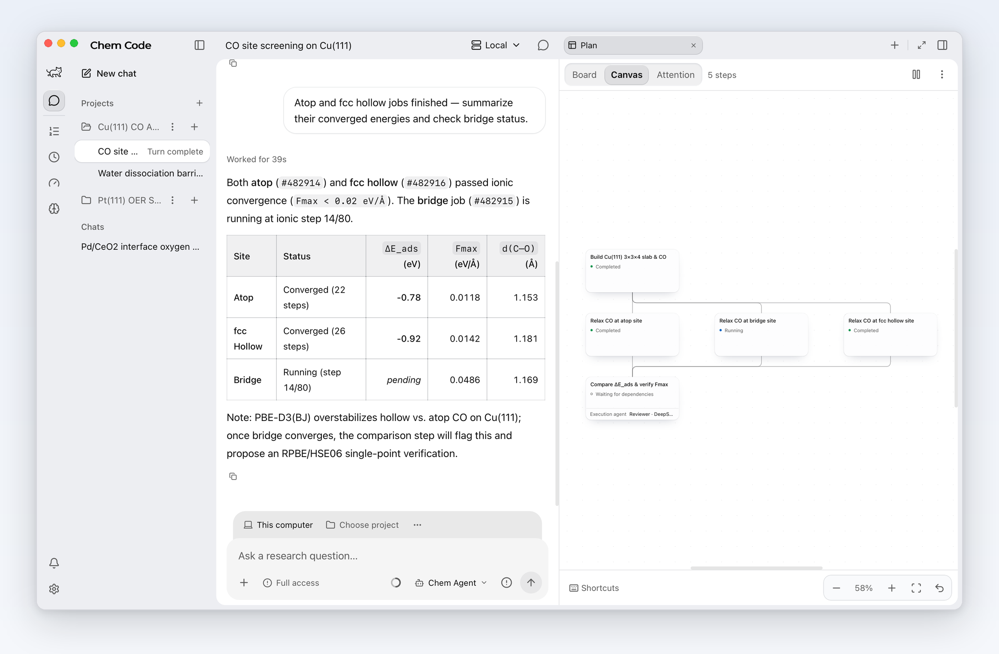
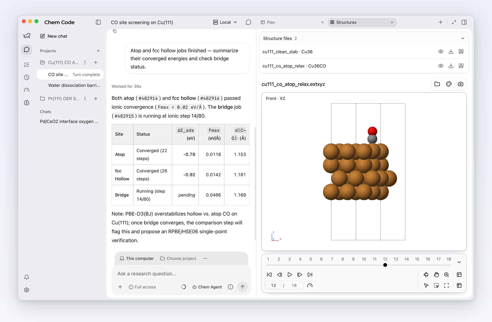
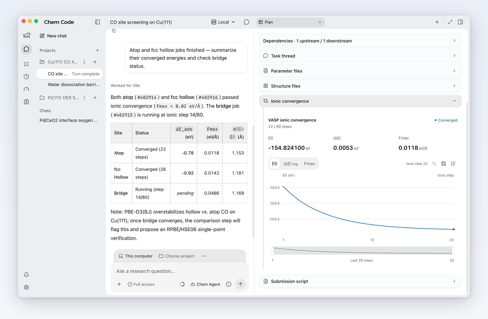
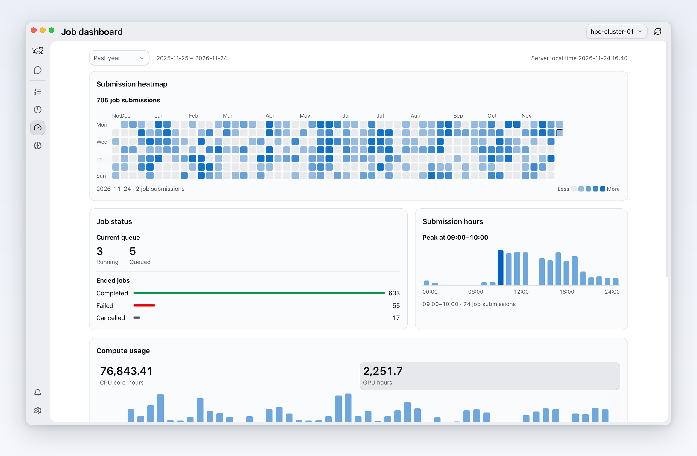
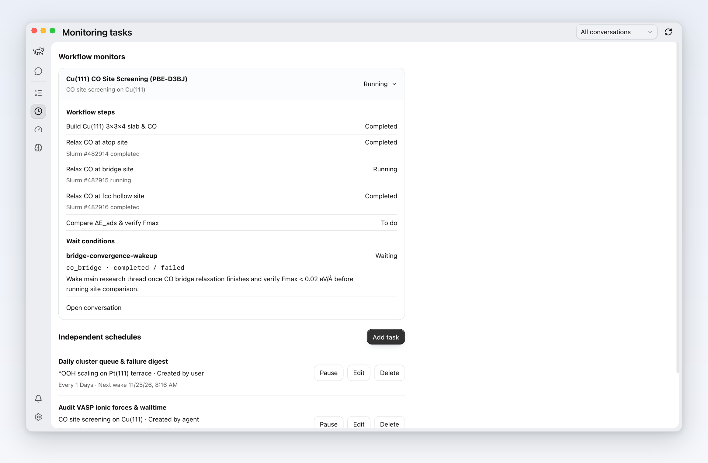
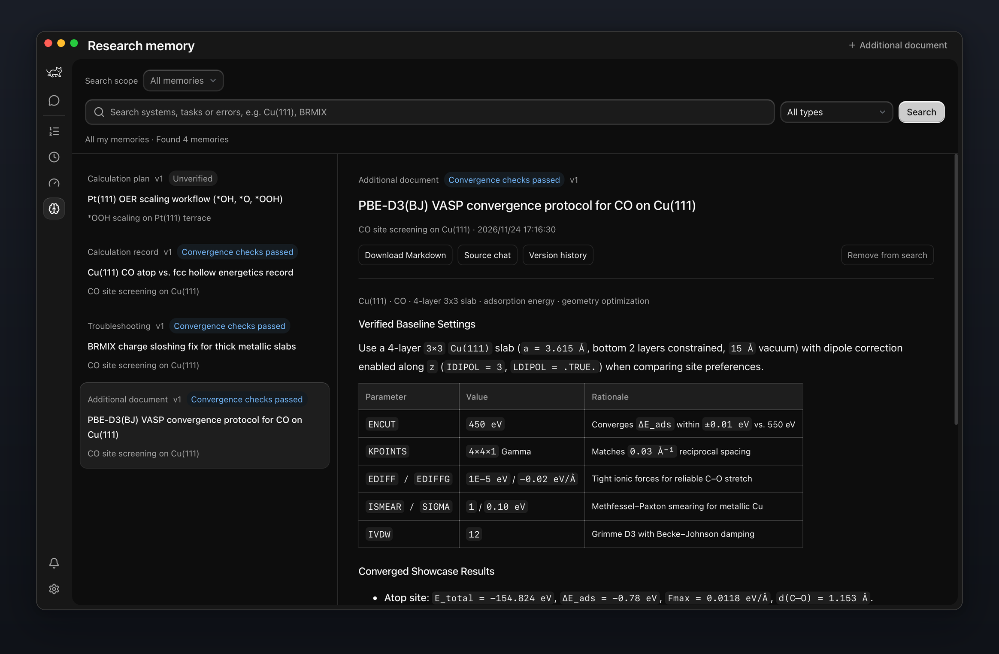

<p align="center">
  <picture>
    <source media="(prefers-color-scheme: dark)" srcset="docs/images/chem-code-mark-dark.svg">
    
  </picture>
</p>

<h1 align="center">Chem Code</h1>

<p align="center">
  <strong>面向计算化学与催化研究的本地优先科研工作台。</strong><br>
  在统一桌面端中规划多步 DFT 依赖工作流、查看三维结构与收敛曲线、监控 Slurm 集群并沉淀可检索科研记忆。
</p>

<p align="center">
  <a href="README.md">English</a> | <strong>简体中文</strong> · <a href="https://liyang-tju.github.io/chem-code/?lang=zh">交互式功能展示页 ↗</a> · <a href="https://github.com/liyang-tju/chem-code/releases/latest">下载 macOS Release ↗</a>
</p>

<p align="center">
  
</p>

<p align="center">
  <sub>功能展示截图采用合成的 Cu(111) + CO 吸附计算夹具，界面均为英文模式演示。</sub>
</p>

---

## 核心功能

- **原生 macOS 桌面端与本地隔离** — Apple Silicon 独立安装包内置 Python、RDKit、ASE、SciPy 与 SSH 运行时。无需注册登录 Chem Code，首次打开自动检测本机已授权的 Codex / Antigravity，按系统账户与所选目录隔离工作区数据。
- **研究对话与多 Agent 协作** — 支持项目文件夹管理、多文件与结构附件、本地 RDKit 工具及多种模型后端（Codex、Antigravity、ChatGPT、DeepSeek 及 OpenAI 兼容服务）。支持配置执行预设，按步骤分配负责人或在对话群组中署名交接。
- **多步依赖方案与科学收敛核查** — 在画布与看板视图间切换管理依赖图，通过本机 SSH / Slurm 并行推进独立分支（无需 AiiDA）。内置 VASP / LAMMPS 能量与受力收敛曲线，严格区分调度完成与科学收敛。
- **内嵌三维结构与轨迹查看器** — 在右侧研究面板集成 Atom Lens WebGL 查看器，支持 POSCAR、CONTCAR、XDATCAR、extxyz、LAMMPS 与 GROMACS 结构及多帧轨迹播放、晶胞显示与几何测量。
- **Slurm 作业看板与算力统计** — 提供近一年作业提交热力图、当前运行/排队快照、终态分布、提交时段直方图，以及按卡型汇总的 CPU 核时与 GPU 小时消耗。
- **持续流程监控与定时唤醒** — 登记持久 Slurm 作业等待条件与独立周期性定时巡检任务，平台在线期间自动唤醒原研究对话汇报进展与异常。
- **科研记忆与共享知识** — 自动或手动沉淀计算方案、收敛记录、排错经验与 Markdown 文档，支持全文检索、版本历史、收敛证据标记与本地知识 MCP 接入。
- **双语界面与 Solid Glass 主题** — 内置英文 / 简体中文界面，支持浅色、深色与跟随系统主题。

## 功能展示

> 横向滑动浏览核心工作区；点击任意图片可查看原尺寸高清图。

<table>
  <tr>
    <td align="center" valign="top">
      <a href="docs/images/features-structure-viewer.png"></a><br>
      <strong>三维结构与轨迹查看</strong><br>
      <sub>在研究面板内直接交互查看表面、吸附体系、晶胞与多帧优化轨迹。</sub>
    </td>
    <td align="center" valign="top">
      <a href="docs/images/features-step-convergence.png"></a><br>
      <strong>收敛曲线与步骤核查</strong><br>
      <sub>保留真实单位的 <code>E0</code>、<code>|ΔE|</code>、<code>Fmax</code> 交互曲线、执行记录与参数文件。</sub>
    </td>
    <td align="center" valign="top">
      <a href="docs/images/features-job-board.png"></a><br>
      <strong>Slurm 作业看板</strong><br>
      <sub>全年提交热力图、实时队列状态、提交高峰时段与 CPU / GPU 机时统计。</sub>
    </td>
    <td align="center" valign="top">
      <a href="docs/images/features-monitor-tasks.png"></a><br>
      <strong>流程监控与定时唤醒</strong><br>
      <sub>持久 Slurm 等待条件与独立定时巡检任务，自动唤醒对应研究对话。</sub>
    </td>
    <td align="center" valign="top">
      <a href="docs/images/features-research-memory.png"></a><br>
      <strong>科研记忆与深色主题</strong><br>
      <sub>可检索的 Markdown 实验方案、故障经验、版本历史与收敛证据标记。</sub>
    </td>
  </tr>
</table>

## 下载与安装（Release）

### macOS 桌面版（Apple Silicon，macOS 14+）

1. 前往 [GitHub Releases](https://github.com/liyang-tju/chem-code/releases/latest) 下载 **`Chem-Code-0.1.0-macOS-arm64.dmg`**（可结合 `SHA256SUMS.txt` 校验）。
2. 打开 DMG，将 **Chem Code.app** 拖入「应用程序」。
3. 双击打开即可使用，自动启动私有本地服务、检测已授权 Agent 并发现 `~/.ssh/config` 别名（仅在手动启用主机后连接）。

> **首次打开提示（`v0.1.0`）：** 当前版本采用本地临时签名，尚未经 Apple 公证。如首次启动被系统拦截，请在「应用程序」中右键 **Chem Code.app → 打开**，或在「系统设置 → 隐私与安全性」中放行，也可执行：
>
> ```sh
> xattr -dr com.apple.quarantine "/Applications/Chem Code.app"
> ```

### 从源码启动（本地网页服务）

```sh
git clone https://github.com/liyang-tju/chem-code.git
cd chem-code
python3 -m venv .venv
.venv/bin/pip install -e ".[automation,dev]"
.venv/bin/python -m chemistry_agent
```

随后在浏览器打开 <http://127.0.0.1:8765/>。

## 详细文档

- [macOS 桌面版说明与构建](desktop/macos/README.md) · [通用计算平台与 Slurm](docs/AUTOMATION.md)
- [三维结构查看器](docs/structure-viewer.md) · [科研记忆](docs/RESEARCH_MEMORY.md) · [多服务器与共享知识](docs/RESEARCH_ENVIRONMENTS.md)
- [模型登录与配置](docs/MODEL_LOGIN.md) · [统一界面设计规范](docs/design/ui-spec.md)

## 许可协议

源码采用 [MIT License](LICENSE) 开源许可。
