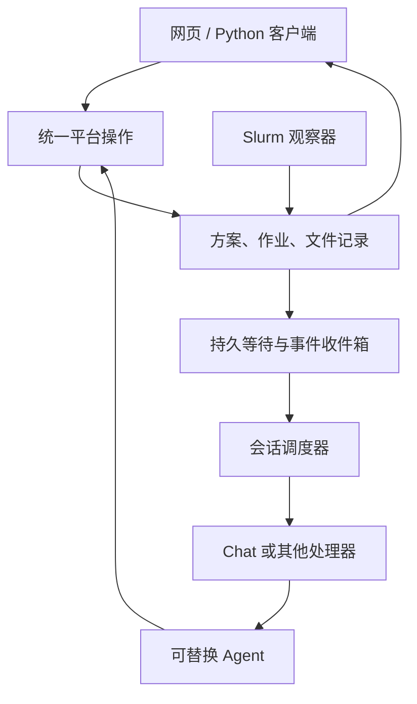

# 独立计算平台

平台保存事实、监控作业和投递事件；Agent 设计科学行动。更换模型或暂时没有模型，不影响已保存的方案、作业、文件和等待条件。本次在同一 Python 后端内建立边界，继续兼容原有记录和界面。

## 模块与责任

| 模块 | 责任 |
| --- | --- |
| `platform/records.py` | 原子保存方案、作业、结构、文件元数据，沿用既有存储路径 |
| `platform/service.py` | UI、脚本和 Agent 共用的带类型操作入口 |
| `platform/jobs.py`、`automation/slurm_jobs.py` | 作业接管、身份核对、状态、原始文件读取和取回 |
| `platform/waits.py`、`automation/wait_ledger.py` | SQLite 持久等待、条件观察、事件收件箱和恢复检查点 |
| `platform/dispatch.py` | 会话占用检查、事件领取、重试、确认和处理器调度 |
| `platform/adapters/chat.py` | 将事件变成原对话的后台 Agent 回合；隐藏事件提示词 |
| `platform/artifacts.py` | 记录来源、时间、哈希的不可变文件快照 |
| `platform/steps.py` | 研究目标结论及采用的作业、文件，与调度器状态分开 |
| `platform/runtime.py`、`platform/lease.py` | 不构建模型客户端的后台；数据目录和数据库的单实例锁 |



## 研究步骤与作业

- `kind: task` 表示 Agent 负责的研究目标，例如“筛选吸附构型”。保存目标、上游依赖、可选 `execution_host`；没有预先写死的科学脚本。
- `kind: model / analysis / job / vasp` 由平台执行器负责已声明的具体操作。`executor` 自动推导且校验，避免两方推进同一节点。
- 已确认的 `task` 上游完成时产生持久 `step_ready` 事件；模型不可用时事件保留。
- Agent 自己写文件、提交，随后用 `job.adopt` 的 `plan_id`、`step_id` 登记。一个研究步骤可关联多个并行作业、候选结构或修复尝试。接管不重新提交作业。
- 子作业保留调度器成功/失败事实。Agent 读取输出后用 `plan.report` 记录 `result`、`accepted_jobs`、`artifact_ids` 和结论依据。研究目标可以在保留失败历史的同时完成。
- 结束研究目标前要求关联作业都已结束，防止仍在运行的作业失去监控。下游依赖研究目标的报告状态；作业退出码 0 不自动代表科学结论正确。
- 子作业继承目标的上游依赖，校验父引用和隐含依赖环。完成后的目标不能改写为另一组结果；新研究尝试另建步骤，保留下游来源。

## 公共操作

通过 `ComputationPlatform.execute(operation, arguments, OperationContext)` 调用；模型工具是同一组处理器的适配层。

| 操作 | 用途 |
| --- | --- |
| `plan.save / get / extend / repair` | 草稿、版本、依赖及执行尝试 |
| `plan.confirm / control / stop` | 确认、暂停/恢复、停止 |
| `plan.report` | Agent 研究目标的结果和证据 |
| `plan.delivery` | 为方案选择命名的事件处理器 |
| `job.adopt / inspect / files / hosts` | 接管、状态、文件和执行环境 |
| `wait.register / control` | 注册、查询、取消及恢复持久等待 |
| `artifact.register / read` | 文件快照登记、元数据及分段读取 |

HTTP 接口（沿用本地服务访问控制，检查会话归属）：

```text
GET  /api/platform/operations
POST /api/platform/{session_id}/operations/{operation}
GET  /api/platform/{session_id}/records
```

POST 请求体为 `{"arguments": {...}}`。操作目录返回实时 JSON Schema。程序入口和 HTTP 入口均沿用确认、版本、授权和防重复语义；绕过聊天界面不代表取消执行授权。

### 文件依赖

Agent 可直接读取任意作业输出，无科学软件扩展名白名单。`artifact.register` 从指定作业取回文件，记录作业身份、源路径、观察时间和 SHA256；同一 `job_id + path + key` 重复注册返回同一快照。再次采样使用新 key。运行期间取回的文件标记为 snapshot，不能冒充最终结果。

节点的 `files` 支持 `artifact_id`，后续执行从本地固定快照复制，避免上游远端同名文件被覆盖而改变计算输入。已有 `node / job_id / file_id` 引用保持兼容。

## 无模型后台与可替换处理器

编辑 `scripts/run_computation_platform.py` 顶部路径后运行：

```bash
python scripts/run_computation_platform.py
```

后台加载记录、观察作业、推进平台负责的确定步骤、记录事件，不构建 ProviderRouter 或 Agent。**同一数据只能由一个新版后台持有**；网页后台和独立后台共享锁。迁移旧版服务前先正常停止旧实例，旧进程不认识新锁。切换时保留数据库、运行数据目录、SSH 配置以及执行环境。

网页部署可设置 `CHEMISTRY_PLATFORM_AGENT_ENABLED=false`，停止新平台事件向聊天 Agent 投递；手动聊天和旧的独立任务恢复配置仍分别受原设置控制。

自定义处理器实现 `DeliveryAdapter.available()` 和 `async handle(Delivery) -> DeliveryResult`，通过 `plans.dispatcher.register(name, adapter)` 注册，再用 `plan.delivery` 选择。示例见 `scripts/verify_platform_replay.py` 的 Python 处理器。处理器启动时须重新注册；选择的名称和待处理事件持久保存。

调度器负责原子领取和确认，处理器负责业务行为。当前沿用会话运行锁和 SQLite 的 `agent_events / agent_waits` 名称以兼容旧数据，名称不表示必须调用模型。用户正在对话时，事件继续等待。

## 恢复与重复执行边界

- 事件等待不调用模型；恢复后查询持久事件，不依赖一次性内存回调。
- 接管作业固定集群、账号、作业号、提交时间和目录；作业号复用不能冒充同一作业。
- 同一事件并发领取只有一个消费者，回答和事件确认在同一数据库事务提交。
- 模型阶段和工具阶段保留检查点。工具副作用结果不明时停止自动重放，先核对真实作业，再恢复或重新登记。
- 任意自定义处理器的外部副作用也必须使用提供的检查点上下文或自身幂等键。数据库事件去重不能保证任意终端命令恰好执行一次。
- 配额拒绝仍沿用完成事件放行等待项的策略，不按时间反复试投。

## 兼容范围和后续迁移

这次已抽出记录仓库、作业/等待操作、事件调度及 Chat 适配器，通用 Slurm 路径可无模型运行。`CalculationPlans` 暂时保留为执行后端；VASP/AiiDA 专用节点、旧诊断与摘要服务仍保留兼容，没有迁移或删除用户历史数据。

界面继续读取同一份方案，已识别 Agent 研究目标及其作业；进度按研究目标汇总，历史失败子作业单独保留。本次未重做整个界面，也未把单用户会话存储改成多用户项目数据库。

后续可沿现有接口继续拆出执行后端协议、迁移旧 VASP 摘要/诊断到统一收件箱，并为外部 Agent 提供独立认证和投递传输。这些不影响现在使用无模型监控与替换进程内处理器。
