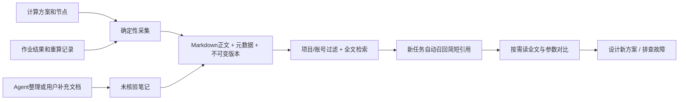

# Chem Code 科研记忆：初版设计与实现

设计日期：2026-11-10。实现分支：`codex/research-memory`，基于 `main@3a86b0b`。

## 1. 为什么从 main 单独开分支

当前 main 已整合对话运行时、AiiDA 自动化、通用计算方案和研究工作区。记忆需要同时服务方案设计、计算监控、故障诊断与普通问答，不宜挂在某一种计算模板或画布 UI 下。

`feat/plan-canvas-design` 有正在进行的画布改动，本次使用独立工作树，不带入这些改动。后续合并 main 后，画布可直接使用同一记忆 API。

## 2. DeepSeek Harness 源码调研

实际克隆了官方仓库 `https://github.com/deepseek-ai/deepseek-harness`，本次阅读固定在提交 `fcc0ad462172522aaf5c93a7b2e01f6b9f0b0159`，提交时间为 2026-11-04。源码临时保存在 `/private/tmp/chem-agent-deepseek-harness-20261110`；实现未复制上游代码。

| 官方能力 | 核查结果 | 本项目取舍 |
| --- | --- | --- |
| 会话持久化 | JSONL 后端追加事件，维护版本迁移、恢复和刷盘语义 | 保留现有聊天/AiiDA 原始记录，不拿摘要替代原始证据 |
| 上下文压缩 | `compaction-basic` 总结较早历史，保留近期内容；属于当前会话管理 | 现有 `ContextManager` 继续负责聊天压缩，科研记忆另建模块 |
| 跨会话检索 | 实验性 session-search 提供五个只读工具；Web/Desktop 默认关闭 | 采用“先检索小摘要，再读取完整文档”的工具边界 |
| 检索底层 | SQLite FTS5；实验性 bundle 首次搜索才打开内存索引 | 使用持久 SQLite FTS5 索引，结合项目/账号范围 |
| 授权 | 工具从执行环境取得调用者身份，跨会话要求相同 cwd | 身份来自当前会话与账号，默认按项目召回 |
| 长期记忆扩展 | CLI 中有 reference-memory、Engram、Memorix 的可选 MCP 接入配置 | 第一版使用本地服务，不依赖额外 MCP 或向量模型 |

因此，官方已有会话记忆和跨会话检索基础，也能接外部长期记忆；不能把社区 `dsh-memory` 插件的自动蒸馏能力当作官方默认功能。阅读的官方模块并未提供计算化学所需的参数、收敛检查和重算经验数据模型。

固定版本源码入口：

- [会话 JSONL 持久化](https://github.com/deepseek-ai/deepseek-harness/tree/fcc0ad462172522aaf5c93a7b2e01f6b9f0b0159/packages/session/session-persistence-jsonl)
- [上下文压缩](https://github.com/deepseek-ai/deepseek-harness/tree/fcc0ad462172522aaf5c93a7b2e01f6b9f0b0159/packages/compaction/compaction-basic)
- [实验性跨会话检索及默认状态](https://github.com/deepseek-ai/deepseek-harness/tree/fcc0ad462172522aaf5c93a7b2e01f6b9f0b0159/packages/experimental/session-search)
- [五个检索工具及权限检查](https://github.com/deepseek-ai/deepseek-harness/tree/fcc0ad462172522aaf5c93a7b2e01f6b9f0b0159/packages/experimental/tool-session-query)
- [FTS5 索引](https://github.com/deepseek-ai/deepseek-harness/blob/fcc0ad462172522aaf5c93a7b2e01f6b9f0b0159/packages/session-query/session-query-sqlite/src/schema.ts)
- [外部记忆服务配置](https://github.com/deepseek-ai/deepseek-harness/tree/fcc0ad462172522aaf5c93a7b2e01f6b9f0b0159/apps/cli/config/examples/mcp-memory)

## 3. 面向计算化学的模型

### 文档类型

- `plan`：目标、方案节点、依赖、模型/分析代码、参数、实际执行状态。
- `calculation`：某一步或单任务的有效参数、输入结构引用、作业标识、结果与报错。
- `lesson`：某一次失败 → 当时修复假设 → 参数/代码变化 → 紧接着的重算结果。
- `document`：用户或 Agent 整理的有用说明、方法、参考资料。可以有参数，但不自动获得成功标记。

共同字段包括标题、Markdown 正文、`systems`、`tasks`、`parameters`、`applicability`、来源会话、稳定源键、版本号、更新时间和 `evidence`。

`systems` 建议使用可重复的明确标签，例如 `Pt(111)`、`CO`、`显式水`、`4×4 slab`；`tasks` 使用 `吸附能`、`反应能`、`NEB`、`结构优化` 等。方案工具新增 `research_systems` 与 `research_tasks`，直接进入记忆。旧方案仍可从标题/正文检索。

**标签用于发现资料，不能证明物理体系相同。** 同一化学式可能包含不同构型、晶面、覆盖度、约束、电荷、自旋及溶剂环境。输入结构内容另存 SHA-256 指纹，用于识别变化；它不是旋转/平移/排列不变的几何相似度算法。

### 可信程度

| level | 含义 | 不代表什么 |
| --- | --- | --- |
| `unverified` | 手写/模型整理的笔记 | 不代表已运行或经工具核验 |
| `observed` | 从原始方案/运行记录采集的事实 | 不保证计算成功或收敛 |
| `converged` | 进程 finished_ok，电子收敛为 true；需要离子收敛时也必须为 true | 不代表方法正确、精度充分或结论可信 |

第一版没有模型可自行授予的 `scientifically_validated` 状态。所有自动记录都保留 `scientifically_validated=false`。未来应通过单独的研究者审核和收敛测试证据支持这一状态。

对于失败 → 修改 A → 仍失败 → 修改 B → 收敛的流程，第一条经验仍显示“修改 A 后失败”，第二条显示“随后重算收敛”。不会将最终成功归因给所有早期修改。多个同时改变的参数也只记录相关性，不生成确定根因。

## 4. 沉淀、检索和复用流程

1. 方案草稿保存后即入库，标明 draft；不会等到成功才保存。
2. 后台 `tick_plan` 同步方案状态，节点结束时记录计算与失败经验。相同内容用摘要哈希去重，轮询不制造重复版本。
3. 旧单任务路径由 TaskMonitor 记录终态结果；恢复预览保留前一作业、参数和原因，后续结束时生成对应经验。旧诊断器自动读取当前项目内最多 3 份历史对照（总计不超过 6000 字节），仍受原有允许修改范围约束。完整 AiiDA 原始数据仍由原系统持有，不复制大型轨迹、CHGCAR、WAVECAR。
4. Agent 可用 `memory_save` 保存整理后的补充文档。禁止把笔记写成工具验证的成功证据；更新需要版本号，自动采集记录不能被笔记覆盖。
5. 新一轮推理按当前用户消息，在当前项目内自动召回最多 3 个简短引用；最多 2048 个本地计数 token，且必须能放入当前请求剩余预算。原文不自动塞满上下文。
6. Agent 用 `memory_search` 分别按体系、任务或报错检索，再用 `memory_read` 读取正文和精确参数。相关但任务不同的体系记录仍能被找到。
   当前轮的检索结果与原文、参数对比一样保留，避免逐条工具压缩吞掉候选 ID；整体请求的上下文预算仍然生效。
7. `memory_compare` 展开嵌套参数并比较 INCAR、kmesh、赝势等字段，区分“字段缺失”和显式 null。缺失代表未知，不猜默认值；差异只是诊断线索。
8. 新方案仍走现有预览、确认和授权流程。记忆不能扩大自动执行权限，也不能让跨会话的旧 structure_id 直接成为当前会话的有效输入；需回到源资料核对并导入当前会话。

索引使用英文/数字词、中文双字片段，以及吸附/adsorption、反应/reaction、能垒/barrier/NEB 等同义词；`Pt(111)` 和 `Pt111` 归一化。不是语义向量搜索，也不会把仅同一元素的所有结构视为同体系。复杂别名和完全无关键词重叠的问题，第一版可能漏检，应改用标签或分开检索。

检索排序先在全部有权限的候选中优先匹配用户明确指定的材料/晶面标记，再对任务类查询优先返回方案和经验，最后使用全文相关度排序。这样避免常见的“吸附能”词或大量短节点记录挤掉 Cu(111) 的长方案；`matched_facets` 表示文本标记命中，并不证明两个原子结构等价。

### 范围与资料边界

所有读写先从服务器当前会话推导账号；模型不能提供 owner_id。模型工具默认项目范围，未分组会话共用该账号的个人区。`scope=personal` 显式查询本人全部项目，绝不查询别人的记录。`scope=session` 严格限定来源会话；精确记忆 ID 读取也检查所属账号。

管理页面默认“仅此对话”，切换来源后立即重新检索；“所属项目”与“我的全部记忆”保留跨对话复用，并明确提示在共享范围内切换对话可能得到相同结果。工作区入口携带当前会话 ID，检索条件保存在 URL，刷新不会丢失。记录与对话列表支持继续加载，结果显示真实来源名称。详情沿用工作区的主题与 Markdown 渲染器；故障经验将原始错误、修复说明、前后参数和证据单独展示，完整原始 JSON/代码仍可展开和导出。

项目归属随源会话的当前分组变化。删除项目后，其对话仍存在，记忆回到该账号的未分组区，符合现有项目文件夹语义。未来如果引入团队共享，应另外设计显式共享 ACL。

召回内容作为“历史资料”加入模型输入，不作为系统指令；不写回聊天历史。网页使用禁用 HTML 的共享 Markdown 渲染器及转义后的结构化字段展示文档，文档里的 HTML 不执行，远程图片不加载。自动采集仅取参数允许列表，不复制 SSH 凭据配置。

## 5. 存储与可维护性

使用现有 `CHEMISTRY_DATABASE_PATH` SQLite 数据库，新增三张表：

- `research_memories`：当前正文、元数据、源键、哈希和移除标记。
- `research_memory_versions`：每次内容变化的完整不可变版本。
- `research_memory_fts`：从文档派生的全文索引。

Markdown 正文是文档内容，JSON 元数据保存精确参数。页面可以下载包含正文和元数据的完整 `.md` 文件；不默认在用户文件系统散落重复副本。现有数据库备份会包含这些表。

手动文档正文上限为 100000 字符。自动采集的超大流程/结果在超过 80000 字符或 160000 UTF-8 字节时，保存带明确标记的摘录及源记录 ID，避免大数组或巨大代码阻断后续记忆采集。未索引部分需要回到原始方案/作业读取，不能因检索未命中而断言没有记录。

“从检索中移除”会写持久标记，并删除索引；后台再次看到相同源记录也不会重新加入。该动作不是隐私数据彻底擦除：原始计算与版本仍保留在数据库中，普通读取/导出接口不再返回已移除记录。

采集或召回失败会记服务日志，不改变计算成功状态，不触发重新提交。方案后台轮询可再次采集；科研记忆关闭时停止自动采集、模型工具、召回和管理 API，已有数据保留。控制变量：`CHEMISTRY_RESEARCH_MEMORY_ENABLED=false`，默认 true。

## 6. 使用方式与接口

从左侧“科研记忆”进入 `/memory`：选对话以确定项目，输入关键词，查看全文与参数，下载 Markdown、查看版本、移除记录或保存补充文档。聊天里可直接说：

> 查一下以前 Pt(111) 的吸附能方案；这次做 CO 反应能，哪些设置可以参考？
>
> 和之前收敛的类似计算比较一下 INCAR、k 点、赝势与结构约束，先列差异再判断。

模型工具：`memory_search`、`memory_read`、`memory_save`、`memory_compare`。

API（均复用现有账号和会话权限）：

| 方法与路径 | 用途 |
| --- | --- |
| `GET /api/sessions/{session}/memories` | query、scope（session/project/personal）、kind、limit、offset 检索 |
| `POST /api/sessions/{session}/memories` | 保存/乐观并发更新补充文档 |
| `GET /api/sessions/{session}/memories/{id}` | 完整正文、参数和证据 |
| `GET .../{id}/document.md` | 下载 Markdown |
| `GET .../{id}/versions`、`.../versions/{version}` | 版本列表、历史正文 |
| `POST .../{id}/forget` | 传 expected_version，移除召回 |
| `POST /api/sessions/{session}/memory-compare` | 与给定参数比较 |

## 7. 第一版边界与后续顺序

第一版已经实现结构化文档、确定性采集、跨会话召回、参数比较、相邻重试经验、版本/移除及管理页面。不会自动遍历科研目录或 `archive`；已有方案随正常后台轮询入库，已有普通聊天和散落文档不批量自动蒸馏。

下一步建议按以下顺序扩展，而不是先接入复杂向量数据库：

1. 研究者可审核的体系词典：晶面、覆盖度、电荷/自旋、溶剂、赝势版本、结构约束，用于适用性过滤。
2. 故障诊断对照集：用真实历史失败与成功重算，评价检索是否找到有帮助的经验、是否出现误归因。
3. 显式选择文档后的导入/整理：与原附件保留映射，支持修订和撤销；避免把普通聊天猜测当事实。
4. 有证据的科学验证记录：能量定义、参照态、单位、ENCUT/k 点/超胞收敛、磁态与构型检查。
5. 在关键词基准上确认漏检问题后，再叠加本地 embedding + reranker；关键词/结构化约束和来源回链继续保留。

这使得“经验越来越丰富”意味着积累可查证的条件、参数和结果，而不是增加未经验证的模型总结。

## 8. 验证记录

2026-11-10 在现有 AiiDA conda 环境执行全套 Python 回归：312 passed、3 skipped；后续超大文档与召回边界调整完成了受影响的 78 项回归及最终 31 项上下文/记忆测试。26 项现有前端测试通过，新增脚本语法检查与 Ruff 检查通过。跳过的是需显式开启的集成测试，本次未向真实集群提交计算。

新增测试覆盖：重启持久化、同体系不同任务、中英文关键词、项目归属变化、账号隔离、并发版本冲突、移除后防止重新采集、证据不可伪造、参数缺失/大小写、逐次失败重算、旧单任务诊断、真实方案生命周期的自动采集、超大记录摘录和自动召回预算。浏览器使用临时合成数据验证了检索、查看来源、补充文档保存及再次检索。

2026-11-11 修复管理页面的会话筛选语义，新增 session 范围和分页回归、Markdown/结构化内容的转义测试。整套 Python 回归 309 项在沙箱通过，7 项依赖本地监听端口的测试在沙箱外复跑通过，3 项集成测试跳过；前端 29 项通过。真实历史副本验证 BRMIX 在 Cu(111) 反应对话命中 6 条经验，在 CO 五晶面对话命中 0 条，扩大到本人全部记忆恢复 6 条；主题跟随工作区设置。
