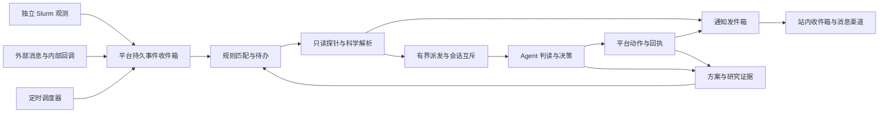

# Chem-Agent 7×24 计算助理

2026-11-19 · 设计评审稿

**建议把 Slurm 观测、外部消息、自定义定时检查汇入 Chem-Agent 的持久事件收件箱。** 后台服务负责接收、去重、匹配规则、生成待办和恢复运行。Agent 只在需要解释证据、判断异常或决定下一步时运行。每条研究事项都有自己的进度和证据，同一会话同一时刻运行一轮，多个会话有界并行。Slurm、科学验收和发给人的通知分别记录状态。

## Anthropic 的直接参考

| 文章或文档 | 对 Chem-Agent 的启发 |
| --- | --- |
| *Introducing routines in Claude Code* | 把任务说明、权限和触发器存成配置，支持托管定时、HTTP 调用和 GitHub 事件。GitHub PR 可按事项关联会话并继续接收更新。通用 HTTP `fire` 每次成功都会创建新会话，且没有幂等键，事件重试可能导致多次启动。我们应在入箱时去重，并明确配置事项和会话的关联。 [产品文章](https://claude.com/resources/articles/introducing-routines-in-claude-code) · [API 语义](https://platform.claude.com/docs/en/api/claude-code/routines-fire) |
| *Scaling Managed Agents: Decoupling the brain from the hands* | 把持久会话事件、Agent 运行循环、执行环境做成独立接口。会话事件可排队，`processed_at` 区分等待与处理完成，会话空闲时保存沙箱状态。Chem-Agent 可以沿用同样的职责边界，用自己的事件和工具记录恢复，并保留本地或 SSH 执行环境。 [工程文章](https://www.anthropic.com/engineering/managed-agents) · [会话事件流](https://platform.claude.com/docs/en/managed-agents/events-and-streaming) |
| *Effective harnesses for long-running agents* | 跨多个上下文窗口持续推进，需要保存任务清单、进展和可重新验证的产物。Chem-Agent 用方案版本、作业回执、待办、检查点和证据引用承载这些信息，接续时读最新状态。 [工程文章](https://www.anthropic.com/engineering/effective-harnesses-for-long-running-agents) |
| *Harness design for long-running application development* | 规划、生成、评估分别有明确交付物，评估通过实际运行取证。计算流程可先用解析器核对退出码、文件完整性和收敛标准，再将有歧义的事项交给 Agent。按任务定义验收条件也可参考 Managed Agents Outcomes。 [工程文章](https://www.anthropic.com/engineering/harness-design-long-running-apps) · [Outcomes 文档](https://platform.claude.com/docs/en/managed-agents/define-outcomes) |
| Managed Agents 部署和 Webhooks | 调度触发成功仅表示创建了会话。Webhook 发送类型与对象 ID，可以按需读取权威对象。暂停新触发和停止进行中的运行是独立操作。 [定时部署](https://platform.claude.com/docs/en/managed-agents/scheduled-deployments) · [Webhook 事件](https://platform.claude.com/docs/en/managed-agents/webhooks) |

## 现有实现与积压风险

| 位置 | 已有机制 | 需要补齐的行为 |
| --- | --- | --- |
| 独立 Slurm 监控 | 多来源、多会话订阅，SQLite 保存事件和投递。活跃状态由 `squeue` 查询，终态由记账或完成日志确认。断线按上次成功的时间补扫。 | 轮询器串行查询集群，每轮使用全库 `snapshot()` 取来源列表。CLI dispatcher 也用全量状态找消费者，按顺序等待各会话完成。一个慢集群或会话会拖延其他来源或会话。`claim()` 读整个消费者收件箱后再过滤；固定租约失联后，任一 `uncertain` 投递会暂停该消费者的后续领取。 |
| Chem-Agent 持久等待 | `WaitLedger` 有状态、文件、`all`/`any`、到期、原子写入命中事件、旧尝试过滤、模型与工具阶段的恢复边界。方案内默认事件可合批。 | `pending()` 一次读取所有可处理项，现有同方案合批缺少条数、字节和时间上限。事件目前绑定方案结构，外部事件和自定义规则仍需要入口与关联语义。 [等待类型](../../src/chemistry_agent/automation/wait_models.py) · [匹配和合批](../../src/chemistry_agent/automation/wait_ledger.py) |
| Chem-Agent 续跑 | `Store.begin_run` 在事务中保护同会话互斥，并优先处理排队的用户消息。`SessionDispatcher` 支持可替换投递适配器。 | 目前每 5 秒遍历所有方案文件，并按方案创建异步任务，缺少全局、模型供应商和项目级的派发额度。批次随 run 标记完成，尚缺稳定的逐事项处理回执。 [派发](../../src/chemistry_agent/platform/dispatch.py) · [会话 run](../../src/chemistry_agent/store.py) · [用户消息队列](../../src/chemistry_agent/chat_queue.py) |
| Slurm 提交与观测 | 已有本地和远端提交回执。丢失 `sbatch` 返回时，用原请求身份查远端回执、`squeue` 和 `sacct`。也已有可切换位置的 observer。 | 同一平台作业应指定一个常规观测来源，并统一映射事件身份。补齐不同 Slurm 版本、数组、重排队、迟到记账和观测切换的测试。 [提交](../../src/chemistry_agent/automation/slurm_jobs.py) · [远端回执](../../src/chemistry_agent/automation/slurm_remote.py) · [观测位置](../../src/chemistry_agent/hosting/monitor.py) |
| 进程部署 | `PlatformRuntime` 可以独立运行监控及计算平台，现有文件锁保护单写者。 | 7×24 部署需要常驻主机、远端访问能力、持久磁盘和恢复演练。现有文件锁限制同一数据目录只有一个执行进程，应先明确生产时由哪一个进程持有它。 [运行时](../../src/chemistry_agent/platform/runtime.py) · [单写者锁](../../src/chemistry_agent/platform/lease.py) |

## 参考实现与选型

检索范围覆盖常驻 Agent、持久工作流、事件和定时编排、通知治理及 HPC 工作流。以下是可核对的代表实现和工程资料。判断基于公开代码和原始文档，实际容量由本地故障注入和压测决定。

| 项目 | 最值得借鉴的实现 | 在 Chem-Agent 中的用途 |
| --- | --- | --- |
| **DBOS Transact Python** | Python 工作流在数据库存步骤检查点，支持持久消息、队列分区、持续调度和补跑。本地可用 SQLite，官方生产建议 Postgres。 | **首选代码参考及扩容候选。** 重点读工作流消息、队列 worker 和故障注入测试。先对照现有 `WaitLedger`、`Store` 的事务边界，再决定是否采用库。 [项目](https://github.com/dbos-inc/dbos-transact-py) · [持久消息](https://docs.dbos.dev/python/tutorials/workflow-communication) · [调度](https://docs.dbos.dev/python/tutorials/scheduled-workflows) · [故障测试](https://github.com/dbos-inc/dbos-transact-py/tree/main/chaos-tests) |
| **DeepSeek Superagent Prototype** | 按来源插件归一触发，持久化事项与执行分配。事务后的工作进入记录化队列，给恢复后会话的投递会用稳定请求 ID 查历史及待处理消息。 | 用它的来源边界和回执协议对照外部事件及 Super-Agent 任务线程的接续。平台可保留原始事件，按当前分配找到任务线程。 [工程架构](https://github.com/deepseek-ai/dsh-superagent-prototype/blob/main/docs/007-architecture.md) · [投递源码](https://github.com/deepseek-ai/dsh-superagent-prototype/blob/8c32a9dc5d72c033816c6a8110b37f40cf94fba4/src/app/delivery.ts) |
| **Temporal、Temporal Agent Harness、pi-temporal** | Signal/Update 传入运行中的持久工作流，Schedule 有重叠及补跑策略。Agent Harness 提供类型化消息与人工处理，项目标为实验性。pi-temporal 保持会话文件和运行状态的边界，明确记录工具结果未知。 | **恢复语义的主要参考。** 借鉴输入先排队、等待不占 worker、活动幂等、明确交接。未来若出现跨主机 HA、复杂跨服务工作流和版本演进需求，再评估 Temporal Server。 [Python 消息](https://github.com/temporalio/samples-python/tree/main/message_passing) · [Schedule](https://docs.temporal.io/develop/python/workflows/schedules) · [Activity](https://docs.temporal.io/activity-definition) · [Harness](https://github.com/temporal-community/temporal-agent-harness) · [pi-temporal](https://github.com/temporalio/pi-temporal) |
| **Hatchet** | Python worker、队列、事件、并发键和分组轮转。持久任务可以等待条件并释放运行槽位，提供队列观察能力。 | 借鉴跨会话公平调度和按项目或集群限流。若主要痛点是积压、优先级与队列运营，列入部署评估。 [源码](https://github.com/hatchet-dev/hatchet) · [Python 任务定义](https://docs.hatchet.run/reference/python/runnables) |
| Restate、Dapr Agents、Pydantic AI | Restate 用持久步骤记录调用结果。Dapr Agents 将 Agent 接入有状态工作流与事件。Pydantic AI 展示如何给同一 Agent 选择不同持久执行后端。 | 用来验证执行适配器接口和运行边界。Restate 的 server 许可单独评估，Dapr 需要对应运行时，Pydantic AI 的持久能力取决于所选后端。 [Restate 步骤](https://docs.restate.dev/develop/python/durable-steps) · [Restate 许可](https://github.com/restatedev/restate/blob/main/LICENSE) · [Dapr Agents 源码](https://github.com/dapr/dapr-agents) · [Pydantic AI 适配](https://github.com/pydantic/pydantic-ai/blob/main/docs/durable_execution/overview.md) |
| Inngest、Trigger.dev | 事件驱动的持久步骤、并发和节流。Inngest 将并发、节流、限频、去抖与幂等作为显式选项。 | 采用这组不同维度的流控语义，部署时再结合 Python 接入与许可评估。 [Inngest 流控](https://www.inngest.com/docs/durable-execution/flow-control) · [Inngest 源码](https://github.com/inngest/inngest) · [Trigger.dev 并发](https://trigger.dev/docs/concurrency) · [Trigger.dev 源码](https://github.com/triggerdotdev/trigger.dev) |
| **OpenClaw、Hermes Agent** | OpenClaw 展示常驻网关、定时任务、按事件启动和回投结果。Hermes 有 Python 的定时与 webhook 接入，定时任务文档明确使用独立会话。 | **入口和用户交互的主要代码参考。** 同一项目允许按规则选择续接原会话或关联的后台会话。研究任务的会话归属、重试和提交权限由平台记录。 [OpenClaw 自动化](https://github.com/openclaw/docs/blob/main/docs/automation/index.md) · [OpenClaw 调度源码](https://github.com/openclaw/openclaw/tree/main/src/cron) · [Hermes 定时](https://github.com/NousResearch/hermes-agent/blob/main/website/docs/guides/automate-with-cron.md) · [Hermes webhook 源码](https://github.com/NousResearch/hermes-agent/blob/main/gateway/platforms/webhook.py) |
| LangGraph、Open SWE、OpenHands | LangGraph 按 thread 保存检查点并可中断恢复。LangSmith Deployment 的 `enqueue` 明确处理同一 thread 的并发请求。Open SWE 有异步编码 Agent 实现，OpenHands SDK 有会话持久化。 | 参考会话续跑、用户介入和执行环境隔离。使用这些框架时仍需确认所选运行时提供哪些队列、调度及多进程能力。 [LangGraph](https://docs.langchain.com/oss/python/langgraph/persistence) · [LangSmith 同会话排队](https://docs.langchain.com/langsmith/enqueue-concurrent) · [Open SWE 源码](https://github.com/langchain-ai/open-swe) · [OpenHands 持久化](https://docs.openhands.dev/sdk/guides/convo-persistence) |
| Dagster、Prefect、Argo Events、n8n | Dagster sensors 的 cursor 和 run key 可用于增量扫描和幂等。Prefect 有响应事件及事件缺席的自动化模式。Argo Events 有 EventSource、EventBus、Sensor。n8n 可独立扩展 webhook 与队列 worker，源码使用社区许可。 | 借鉴数据就绪传感器、未收到心跳的规则和入口扩展。外部集成多时可由 n8n 等转换常见消息，再投递到统一入口。 [Dagster sensors](https://dagster.io/docs/guides/automate/sensors) · [Prefect 自动化](https://docs-customer-managed.prefect.io/overview/prefect-services/) · [Argo Events](https://argoproj.github.io/argo-events/) · [n8n 队列](https://docs.n8n.io/hosting/scaling/queue-mode/) · [n8n 许可](https://docs.n8n.io/sustainable-use-license/) |
| Celery、Kestra、Windmill | Celery 区分任务确认与执行，并要求周期调度注意单调度器及任务重叠。Kestra 和 Windmill 有可配置的定时入口和运行历史。 | 用 Celery 的交付语义检查 worker 边界，用 Kestra 和 Windmill 的定时配置参考试运行与执行历史。 [Celery tasks](https://docs.celeryq.dev/en/stable/userguide/tasks.html) · [Celery 定时](https://docs.celeryq.dev/en/stable/userguide/periodic-tasks.html) · [Kestra](https://kestra.io/docs/workflow-components/triggers/schedule-trigger) · [Windmill](https://www.windmill.dev/docs/core_concepts/scheduling) |
| APScheduler、Kubernetes CronJob、Google SRE | 明确定义错过触发、重叠、时区及调度身份。Google SRE 讨论了任务记录成功与外部派发成功之间的故障窗口。 | 复用成熟的时间表达式解析，用原定时间和规则版本保存实际触发记录。依赖前锁定 APScheduler 主版本并验证对应 API。 [APScheduler 3.x](https://apscheduler.readthedocs.io/en/3.x/userguide.html) · [APScheduler 新版设计](https://apscheduler.readthedocs.io/en/master/userguide.html) · [CronJob](https://kubernetes.io/docs/concepts/workloads/controllers/cron-jobs/) · [Google SRE](https://sre.google/sre-book/distributed-periodic-scheduling/) |
| AWS Step Functions、Azure Durable Functions | 托管方案也将流程等待持久化，允许外部回调或事件使流程继续。Azure 文档明确外部事件按至少一次投递考虑去重。 | 参考外部回调如何绑定到具体等待实例。以现有 Python/SSH 部署为首期基线。 [AWS 回调任务](https://docs.aws.amazon.com/step-functions/latest/dg/connect-to-resource.html) · [Azure 外部事件](https://learn.microsoft.com/en-us/azure/azure-functions/durable/durable-functions-external-events) |
| CloudEvents、Stripe、NATS JetStream、Alertmanager | CloudEvents 定义 `source` 与 `id`。Stripe 说明 webhook 可能重复或乱序。JetStream 展示显式 ACK 与重投。Alertmanager 有分组、抑制、路由和归并。 | 将这些模式用于入口契约与通知，接收时保留事实，后续按需要归并。如果跨服务事件持续增长，JetStream 是消息传输候选。 [CloudEvents v1.0.2](https://github.com/cloudevents/spec/releases/tag/ce@v1.0.2) · [Stripe webhook](https://docs.stripe.com/webhooks) · [JetStream](https://docs.nats.io/learn/jetstream/pull-consumers) · [Alertmanager](https://prometheus.io/docs/alerting/latest/alertmanager/) |
| **FireWorks、jobflow、Custodian、AiiDA** | 高通量科学工作流已有依赖、来源追踪、重复检测和基于计算类型的错误处理。jobflow 以输出引用连接步骤，Custodian 能编排程序级错误处理和验证。 | 复用现有科学解析和证据引用，按计算类型加可验证的验收规则。FireWorks 和 AiiDA 提供研究状态的设计参考。 [FireWorks 论文](https://perssongroup.lbl.gov/papers/cpe2015-fireworks.pdf) · [源码](https://github.com/materialsproject/fireworks) · [jobflow](https://materialsproject.github.io/jobflow/) · [Custodian](https://materialsproject.github.io/custodian/) · [AiiDA 引擎论文](https://arxiv.org/abs/2007.10312) |

**首期选型为现有 Python + SQLite，保留 `Store` 与会话 run 的同库事务。** 先沿用现有持久等待、工具检查点与 Slurm 回执，把首轮工程量放到来源接入、稳定身份、按事项记录、有界派发和故障注入。若持续延迟来自单写者或需要跨主机容灾，再迁到 Postgres 并验证 DBOS 或 Hatchet。若出现大量跨服务信号、很长的工作流历史和多版本并行运行，再对比 Temporal。迁移前用同一套重复事件、进程崩溃和提交对账场景做对照。直接复用第三方代码时固定提交版本并核对许可与归属声明。

## 运行结构

### 事件契约和数据归属

- **事件是已经发生的事实。** 采用版本化字段 `source`、`id`、`type`、`subject`、`occurred_at`、`received_at`、`schema_version` 和有限大小的 `data`。`UNIQUE(source,id)` 去重，同一身份收到不同正文时记录冲突。以内部单调序号分页和追踪游标。原始输出存现有工作目录或产物存储，事件只存引用、摘要和必要校验信息。
- **规则定义何时行动。** 规则记录所属项目/所有者、来源、可用的事件类型、过滤器、关联键、目标会话、方案和动作策略、版本、启停及失效时间。默认从启用时的游标开始。历史导入保留 `backfill` 标记，默认用于补证据和对账，自动推进需明确配置。平台拿当前方案版本、执行者和授权复核，授权撤销或尝试过期时持久记录跳过原因。
- **待办是可单独处理的一件事。** 为命中生成稳定 ID，可由规则版本、逻辑目标、动作和关联事件或等待实例派生。去重以语义为单位。同一作业可以送达多个会话，重叠订阅命中相同目标和同一动作时归并，独立验收事项保留独立 ID。多个会话均可判读，同一方案步骤的提交、取消及状态推进只归一个执行者。把计划 `executor` 与提交权限同时落实到工具入口。
- **四种确认各自持久化。** 来源 ACK 表示平台已接收。待办完成表示判读或已登记后续等待。动作回执表示外部操作已确认。通知送达表示界面或渠道接收。再分别记录 Slurm 终态、输出是否可用及科学结论。通知标为已读只修改用户阅读状态。
- **跨进程交付采用至少一次与幂等。** Slurm 侧保留事件与消费游标，通过专用桥接消费者分页领取。Chem-Agent 成功提交事件后才 ACK 来源。中间崩溃时允许重投同一身份。平台侧在同一数据库事务写入事件、待办或待路由标记，处理器用唯一键防止重复匹配。先保留方案 JSON，涉及 JSON 和 SQLite 的投影用稳定步骤版本和定期对账补齐。数据库提交与通知发送用事务发件箱衔接。 [事务发件箱模式](https://docs.aws.amazon.com/prescriptive-guidance/latest/cloud-design-patterns/transactional-outbox.html)

### 与 Super-Agent 的接入边界

7×24 平台持有来源身份、定时规则、观测游标和事件收件箱。Super-Agent 持有 `plan_id + node_id` 到任务会话、后端原生线程和分配版本的绑定。双方使用同一个 `WaitLedger` 和 `SessionDispatcher` 续跑。接入时区分方案归属会话与执行目标会话。归属会话继续用于查方案和权限。事件在领取前按步骤、子作业的 `parent_task` 或已登记的等待解析目标，按实际目标线程及分配版本合批和互斥。旧方案沿用已有的会话路由。

投递回执记录稳定待办 ID、对应来源事件 ID、平台 run ID、目标会话和分配版本。线程更换只影响后续领取且尚未发出的待办。在途回合进入显式交接或结果核对，旧分配的迟到工具调用由平台校验当前授权和分配版本。这样独立 Slurm 监控和定时入口均可提前接入，原生线程实现只需提供目标解析和已有投递适配器的能力。 [Super-Agent 产品设计](super-agent-product-design.md) · [现有派发器](../../src/chemistry_agent/platform/dispatch.py)

### 独立 Slurm 桥接配置

独立监控可用 `MonitorClient.register_platform_bridge("chem-agent")` 注册专用消费者，再按队列、账户和 job ID 添加订阅。首次启用可以传 `after_event_id=None` 从新入库事件开始，也可以选择 `0` 补读已保留历史。将 Chem-Agent 的 `CHEMISTRY_SLURM_BRIDGE_URL`、`CHEMISTRY_SLURM_BRIDGE_CONSUMER` 和 `CHEMISTRY_SLURM_BRIDGE_TOKEN_FILE` 指向该服务及其私有令牌文件。配置 `CHEMISTRY_SLURM_BRIDGE_QUEUE_HOSTS` 将监控的队列 ID 映射到平台计算主机 ID。明文 HTTP 只接受回环地址。 [配置示例](../../.env.example) ·

每页最多 100 条投递。平台以持久 `hub_id + event_id` 去重来源事实，单独记录订阅投递 ID，同一事务提交整页后才确认。桥接租约在 30 秒后允许重领，CLI 消费者仍沿用原有待核对策略。同一来源 ID 如出现不同正文，整页回滚并保持未确认。带终态的记录只为匹配到的**当前已登记作业**提前一次只读检查，未配置映射或找不到作业身份的记录留在收件箱。实际调度和产物核验仍走原流程，之后由 `WaitLedger` 和 `SessionDispatcher` 续接对应任务线程。 [桥接实现](../../src/chemistry_agent/platform/slurm_bridge.py) · [EV-02 用例](../../tests/automation/test_slurm_bridge.py)

### 三类来源的行为

| 来源 | 首期接入 | 必须处理的边界 |
| --- | --- | --- |
| **Slurm 和结果产物** | 独立监控继续只读观测。先按来源持久化再分页推给 Chem-Agent，基于当前 job/adoption 记录匹配内部方案和尝试。平台执行者继续管理提交、取消和回执。 | 每集群批量查询带独立限速、超时和熔断。`squeue` 消失先记为待核对，之后以 `sacct` 或可信完成记录确认。补查保留重叠窗口和周期性对账。记账中断或超出保留期时显示数据缺口。支持数组任务、重排队、迟到终态和编号复用。 [sacct](https://slurm.schedmd.com/sacct.html) · [job array](https://slurm.schedmd.com/job_array.html) |
| **其他消息事件** | 优先用一个已认证的 HTTP 入口和内部回调。每种来源映射为明确事件，如 `artifact.ready`、`approval.received`、`storage.threshold_crossed`。再添加邮件或聊天渠道适配器。由受控规则决定审阅、等待解除、通知或启动关联会话。 | 按渠道校验签名或服务凭据、消息大小、允许事件类型及来源所属项目。先落库再快速返回成功，处理异步执行。按来源事件 ID 去重，过晚或乱序的事件用版本和权威状态判断。消息正文、附件、远端日志均作为数据处理，不能赋予工具权限。系统自己的回执及通知带因果 ID，默认不回触发原规则，避免反馈循环。 [Webhook 实践](https://docs.stripe.com/webhooks) |
| **自定义定时和监控** | 支持一次性、固定间隔与带 IANA 时区的 cron。触发产生 `schedule.due`，然后运行有类型的无模型探针，如文件稳定性、配额、长时间无进展或汇总。仅在规则命中或需要判断时启动 Agent。 | `schedule_id + revision + scheduled_at_utc` 唯一，生成 tick 和推进时间游标同事务。保存用户时区、原计划时间、实际执行时间、规则版本和漏跑记录。明确夏令时两类边界，试运行可预览接下来触发时间。修改时间表时按版本的生效区间补扫，避免把新规则应用到过去。 [Google SRE](https://sre.google/sre-book/distributed-periodic-scheduling/) · [DBOS 补跑](https://docs.dbos.dev/python/tutorials/scheduled-workflows) |

Slurm 的逻辑作业、数组元素、平台尝试与调度器的每次运行分别建关联。监控侧优先使用已探测版本支持的运行标识（例如 `SLUID`），结合 `--duplicates`、`Submit`、`Restarts` 信息和已登记作业做对账。旧版本没有可确认的运行身份时保留歧义。终态的旧实例不能覆盖已 requeue 的当前实例。结果文件使用对应尝试的清单、大小稳定窗口或完成标记，避免 Slurm 已结束但共享文件系统尚未可稳定读取。 [Slurm 记账字段](https://slurm.schedmd.com/sacct.html)

定时规则有两个独立开关。**错过触发**默认合并成一次最新检查，记录覆盖区间。也可跳过，或对显式选择的任务在有限窗口内逐次补跑。**执行重叠**默认至多一个执行中的检查，忙时合并一个待检查项。能并行处理独立时间分区的任务可配置有界并发。建议 cron 对夏令时跳过不存在的本地时刻，重复的本地时刻只取第一次，并在预览里显示 UTC 时间。暂停阻止创建新 tick，重新启用按所选补跑策略执行，正在跑的检查可单独停止。无进展和无心跳规则在来源健康且观测新鲜时才判定超时，来源失联发一条独立健康事件。阈值触发保存上次判断和恢复阈值，避免配额等指标来回波动时重复唤醒。

### 多事项和通知洪峰

1. **先持久化，再节制下游工作。** 上游看到成功时事件已保存。使用按时间和主键分页的接收、匹配、待办和发件箱查询。每个观测来源有独立的超时、退避及游标。对大数组集中查 Slurm 和结果清单。过载时放慢补历史、摘要和非紧急模型运行。数据库容量告警后给未能持久接收的请求返回可重试错误，由支持重试的来源补送，并用周期性对账覆盖来源限期。 [Slurm RPC 成本](https://slurm.schedmd.com/sbatch.html#SECTION_PERFORMANCE) · [拉取和重投](https://docs.nats.io/learn/jetstream/pull-consumers)
2. **用确定性规则先分类。** 重复观测只更新事实，普通状态变化只投影到看板，已有解析规则的结果先做批量自动核对。只有异常、方案关口、用户订阅或需要判断的结果变成模型待办。所有原始事件可按牵涉的作业或计划查到。成功项可汇总，需即时处理的故障单发。来源故障时聚合一条集群告警，避免把查不到状态的作业各自报成失败。 [Alertmanager](https://prometheus.io/docs/alerting/latest/alertmanager/)
3. **会话串行，会话间公平并行。** 维护每会话一个 run，保留用户消息优先和停止指令。任务选择先按紧急度，再按项目或会话轮转。为运行池、模型供应商和集群设并发额度，交互请求有独立预留额度，普通待办随积压时间提高优先级。计划内互相依赖的动作串行，独立只读解析可以并行。供应商 `429` 按 `Retry-After` 及带随机扰动的退避延后，达到重试和成本预算后保留待办与恢复入口。 [Hatchet](https://docs.hatchet.run/reference/python/runnables) · [Inngest 流控](https://www.inngest.com/docs/durable-execution/flow-control)
4. **合批有边界，确认到事项。** 同项目、会话、方案和权限范围内才合批，按条数、JSON 大小与等待窗口封顶，未领取的留在队列。Agent 的输入带待办 ID、当前方案版本、前次决策及证据引用。每项可提交 `handled`、`waiting`、`needs_review`、`retry_at` 或 `superseded` 及相应证据。模型输出须通过平台校验并持久提交。一轮只处理了部分事项时，其余保持待处理。在页面显示积压数量、最老事项和按原因暂停的事项。
5. **通知与 Agent 派发独立。** 通知经持久发件箱按分组键、安静时段、静默和紧急级别发出。重试通知只使用通知 ID 和发送回执。外部渠道如果没有幂等或状态查询且回执超时，标注送达待确认，按渠道策略继续。通知点击打开相关作业、方案、待办或原会话。对用户分别展示待处理、正在判读、等证据、需确认及已解决。

建议从 **普通批次最多 32 项或 32 KiB、最长聚合 10 秒，紧急事件立即入派发队列** 开始测。并发初始用 **全局 4、同会话 1**，实际值按模型供应商和远端 SSH 配额调整。若 10,000 项全都必须由 Agent 判读，即使每轮处理 32 项也至少 313 轮。同一会话串行且假设每轮耗时 30 秒时，清空至少约 2.6 小时。容量验收应同时测原始事件吞吐、需要模型的比例、实际每轮完成项目数及最老事项延迟。

### 恢复、暂停和计算副作用

| 故障点 | 恢复行为 |
| --- | --- |
| 拉取、入箱或 ACK 中途断线 | 从来源游标补读，按稳定事件 ID 去重。桥接器只做入箱，可在同一领取 ID 过期后安全重投；CLI 适配器保留其需要核对会话结果的策略。 |
| 派发进程失联，会话 busy 或 Agent 尚未触及外部动作 | busy 保持待办，待会话空闲。可安全恢复的步骤按已提交检查点续跑。跨进程领取需要短事务、租约续期和代次校验。数据库拒绝旧代次的状态写入。已经发出的远端动作仍走回执对账。 |
| `sbatch` / `scancel` 发出后回执丢失 | 在外部调用前为具体动作写入稳定 `action_id`、请求摘要、权限版本及目标作业或工作目录。复用现有回执和唯一提交标识对账。一致且唯一才自动补记成功。模糊结果保持 `uncertain`，暂停涉及同一资源的后续写操作，继续无依赖事项。每条重复动作返回原结果或明确冲突。 |
| Agent 回复已提交但通知失败 | 保留已生成的结论和动作。通知 worker 按发件箱补发或记录送达不确定，Agent 无须再运行。 |
| 用户暂停、撤销授权、修改方案或取消 | 领取和副作用前都查最新版本。暂停触发、停止 Agent、取消待办、取消远端作业分别记录。远端取消有自己的回执。旧尝试的迟到事件仍可供审计，下一步只能由当前有效尝试推进。 |
| 远端文件未写稳、解析失败或证据冲突 | 保持等待产物或复查状态，按次数与时间上限复查。无法确认时明确提示证据缺口。重新解析记录输入指纹、解析器版本、单位和判据。 |

数据库事务可保证本地状态和动作意图的一致性。远端 SSH、Slurm 和通知渠道通过幂等及回执对账实现可恢复交付。对外部工具已经发出、结果又未知的情况，只有外部证据可确认是否执行。Agent 能提出下一步，平台按当前授权、计划执行者、作业数、资源上限及重试次数决定动作是否准许。 [Temporal Activity 语义](https://docs.temporal.io/activity-definition) · [pi-temporal 未知结果处理](https://github.com/temporalio/pi-temporal)

**科学验收始终针对当前有效的尝试。** 例如 VASP 结构优化要分别记录程序退出、电子和离子收敛、现有输出的完整性以及异常判据。退出码 0 只可触发读取和判读。若需重算，依据判据和最新方案授权提交新尝试，保存原尝试的记录和证据。批量 NEB 或振动分析的汇合条件需要明确预期子任务集合、允许的失败或缺失条件，以及何时才做整体判断。

### 同一研究项目的三种触发

某个项目同时等待一批吸附构型的优化结果、一份外部结构清单，以及每晚一次的运行健康检查。Slurm 终态先更新各个构型的运行记录，批量解析器注明哪些收敛、哪些产物还在等待。结构清单的 webhook 只解除与其 `manifest_id` 和方案版本对应的等待。每晚的定时检查统计待处理构型和过期来源，普通状态生成摘要，确有异常时生成单独待办。属于同一会话的待办依次进入 Agent，彼此保留自己的状态，另一项目的事件可以在其他运行槽位并行处理。若某个构型的重算已发出但回执不明，只冻结该构型的执行决定，其余构型继续判读。

## 分阶段实施与验收

| 阶段 | 交付内容 | 验收方式 |
| --- | --- | --- |
| **1 · 接通 Slurm 与收件箱** | 为独立监控增加分页领取和平台接入适配，沿用源端订阅。平台在受控收件箱保存来源键、游标和待办关联。为现有自动唤醒增加有界批次、活跃队列查询、全局及同会话并发控制与逐项回执。 | 在两个隔离的模拟集群里注入相同 job ID、多对多订阅、重复/乱序/迟到终态及数组重排队；在平台提交前后、源 ACK 前后杀进程。每个有效事件可查且只产生应有待办。灰度阶段同一项目只有一个派发者，另一侧只比对观测，不同通道不得重复唤醒或推进同一步骤。 |
| **2 · 恢复边界和常驻部署** | 动作账本对接现有 SSH/Slurm 回执，复核授权与部分完成，按阻塞资源隔离疑难回执。选能访问集群且有持久磁盘的常驻主机，服务管理器自动重启，加入备份、探活和审计。 | 使用模拟 `sbatch` 模拟已接单但返回丢失、操作完成但进程崩溃、租约过期旧 worker 回写。已确认提交最多一次，未确认的进入对账。源端掉线、Agent 供应商不可用和桌面断开期间维持事件记录，重启后限速追赶。用获准的远端只读查询验证真实集群差异。 |
| **3 · 外部事件与定时** | 发布一个认证来源及一个可配置的只读探针，使用统一规则、目标路由和待办。可按项目查看触发历史、暂停、试运行和定时补跑范围。 | 伪造或越权来源被拒绝，签名有效的重复消息只生效一次。覆盖跨时区、夏令时、改表达式后补跑、跨停机窗口、并发触发及触发循环。手动试运行产出可核验的来源与规则记录。 |
| **4 · 通知及峰值验证** | 用站内收件箱和现有渠道接发件箱，配置聚合、静默、健康告警。根据队列与数据库负载决定是否迁移 Postgres 或引入持久引擎。 | 用假模型与模拟集群压测，测试来源端拥堵、模型端降速和外部渠道异常三者能独立恢复。把同一套故障场景作为引擎对照测试。 |

部署操作至少覆盖本机休眠、宿主机重启、SSH 权限失效、模型配额、记账保留和数据库恢复。单机 SQLite 首期应存本机持久磁盘，备份包含一致数据库快照和提交回执，演练用上次备份与来源游标恢复。用户停止某项监控后，系统应保留其历史和最后游标。常驻服务的 RPO/RTO 取决于备份频率、持久存储和来源可补查范围。

第一轮压测用 **5 分钟 10,000 条唯一事件**，另加重复重投。让其中一个会话集中收到大批数组作业事件，同时注入其他会话的普通待办、用户消息和告警。验证积压时紧急待办可被选中、低流量会话持续推进、批次始终有界、逾期或未知结果能定位到事项，并统计误判、重复提交、遗漏和模型消耗。入口目标暂定 **持久 ACK p95 <500 ms**，紧急事项从入箱到派发队列暂定 **p95 <30 s**。会话已占用时，从派发队列等到实际启动的时间单独计量。外部观测延迟、模型耗时和科学验收耗时各自计量。

常驻监控需要看 **来源最后成功时间、游标滞后、待办最老年龄、各状态积压、重投与去重率、诊断中的 `uncertain`、模型用量、每集群查询错误和通知失败**。用事件 ID、待办 ID、run ID、动作 ID、Slurm job ID 串起审计。错误项进入可检查的隔离列表，重放时指定范围及是否可生成动作。保留必要的审计和去重键，明细与大日志分级留存，清理前确保可由历史来源安全补证据。

本轮基线验证使用临时数据与测试替身。Chem-Agent 的持久等待、任务事件、唤醒内容、模拟 Slurm 提交和用户消息队列共通过 51 项测试。独立监控单元测试通过 14 项。真实集群、事件峰值和断电恢复仍是部署验收项。
