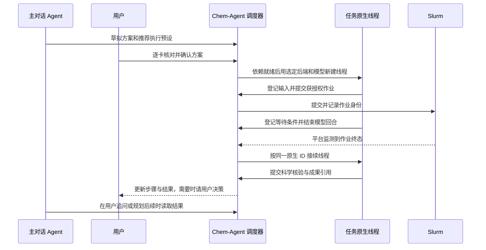

# Chem-Agent Super-Agent 产品设计

2026-11-19 · 设计提案

首版实现覆盖 Codex 与 agy 执行预设、草稿逐任务分配、独立原生线程和受控 Slurm 提交。预设与实例集中在独立的「Agent 与模型」页。未分配的步骤由主对话路由。任务详情显示审批和线程记录。已确认方案保存选定的预设版本，首次模型运行按需创建线程。

与 [7×24 计算助理](always-on-computation-agent.md) 共用持久等待账本、事件派发器和 Slurm 作业记录。Super-Agent 提供方案所属会话与任务执行会话的映射。7×24 的后续外部事件和定时规则提交到同一个持久入口，再由平台解析执行目标。

首版验收用本机 Codex CLI 0.164.0（GPT-6.1 Terra，高）与 agy 1.5.11（Gemini 3.8 Flash，低）执行同一方案，两个原生线程在重启后均接续并写入步骤报告。模拟 Slurm 记录了两次提交。回归测试向两条线程写入不同标记并检查主模型输入，原始任务记录留在各自线程。 [端到端测试](../../tests/automation/test_task_agents.py)

Chem-Agent 的 **Super-Agent** 由主对话里的协调 Agent 和平台执行器组成。主对话理解研究目标、拟定方案、提出分配建议和汇总结果。用户在方案卡片下选择执行预设。依赖就绪后，平台用指定的 **Agent 后端、模型和推理强度，创建或接续这个步骤自己的原生线程**。Codex、Antigravity CLI（`agy`）、Gemini CLI（`gemini`）、Claude Code 和 DeepSeek Harness（DSH）都可以成为执行后端。一份方案可以同时使用多个后端，同一个 Codex 实例也能为不同任务开不同线程。

## 产品结构

| 对象 | 用户看到的内容 | 例子 |
| --- | --- | --- |
| Agent 实例 | 已连接的程序、运行主机、版本及登录状态 | 本机 Codex、运行在指定主机的 DSH |
| 执行预设 | 实例、模型、推理强度、可选科研指令和技能、任务的工具上限 | `结构生成 · agy`、`NEB 专家 · Codex 高推理`、`报错诊断 · DSH`、`NEB 复核 · Claude Code` |
| 方案任务 | 目标、依赖、验收条件和实际选定的执行预设 | `检查 NEB 路径与收敛 → NEB 专家 · Codex 高推理` |
| 任务线程 | 后端的原生会话，关联该任务的历次回合、作业和成果 | NEB 提交前的 Codex 回合，和两天后在同一个 Codex thread 中进行的结果检查 |

每项任务可以选自己的组合。预设名称用科研用途表达意图，实际执行配置可随时从卡片详情核对。用户也可以保存按后端或强度命名的通用预设，用同一后端的中推理做常规任务、高推理做难题。主对话的 Agent 和模型由其自己的配置决定，任务分配单独保存。

## 首版体验评审

以筛选多个晶面与吸附位点、再为候选路径跑 CI-NEB 为例。研究者通常会重复使用同一套结构生成、路径计算和结果复核配置。首版把任务原生线程与主对话隔离，下一步的效率来自减少重复分配、缩短人工阻塞，以及让下游直接拿到可信的科学产物。

| 优先级 | 首版观察 | 产品改进与验收 |
| --- | --- | --- |
| P0 · 项目默认与批量分配 | 草稿分配接口每次只改一个任务。位点筛选扩成多条路径时需要重复点卡片。 | 项目按结构生成、路径计算、诊断和复核配置默认预设。方案确认前按任务类型或分组批量应用，显示受影响卡片，并保留逐卡覆盖。用一份 24 卡模拟方案记录手工分配次数、覆盖次数和用户能否核对每卡的最终配置。 [分配逻辑](../../src/chemistry_agent/platform/task_agents.py) |
| P0 · 方案待处理 | 脚本审批和原生线程状态集中在步骤详情，用户要逐卡查看哪些分支需要介入。 | 在方案上汇总待审批脚本、待核对提交和无法恢复的线程。直接跳到原任务、脚本与证据，处理后接续原线程。记录从出现待处理到用户找到并处理的耗时，并验证重复事件只显示一项。 [任务详情](../../src/chemistry_agent/web/task-thread.mjs) |
| P1 · 独立分支推进与交接 | 派发已按任务线程占用名额，并限制后台并发。已确认任务的分配仍锁定。 | 在界面展示任务自身的等待原因和影响范围。连接故障或额度耗尽时，允许显式交接给另一预设，保留旧线程、已有成果和 Slurm 作业 ID。核对旧线程晚到的回报与切换负责人的提交次数。 [事件派发](../../src/chemistry_agent/platform/dispatch.py) |
| P1 · 可核验的科学交付 | 现有报告可引用作业和产物，结果字段接受通用数据。下游还需确认采用哪个结构、路径和参考态。 | 优先定义结构和 NEB 交付字段。结构记录晶胞、原子顺序与映射、固定层及来源。NEB 记录同一协议下的参考态、能垒和单位、逐像受力、验收阈值、候选鞍点与核验状态。下游以已采用的产物引用启动，证据可回到对应结构、作业和日志。用缺失或未通过科学阈值的模拟路径验证其后的复核步骤等待。 [步骤回报](../../src/chemistry_agent/platform/steps.py) · [方案输入引用](../../src/chemistry_agent/automation/plan_models.py) |

## 方案工作台与异常交互

用户打开方案后，先能判断哪些步骤会继续、哪一步需要自己决定，以及决定后会发生什么。主对话发起和修订科研目标，独立的「Agent 与模型」页管理可复用预设，执行中的任务通过现有方案看板与步骤详情操作。界面入口按研究对象组织，任务保留各自的原生线程。

首批落地内容为方案工具栏的「待处理」、原步骤的脚本审批、提交回执核对，以及声明 `neb_force_target` 的 NEB 路径验收。验收读取提交时锁定的阈值和最终路径快照。运行中交接及其余例外见下方目标交互。

### 三个相邻的界面

- **方案看板或画布。** 草稿卡底栏选择执行预设，批量应用先显示影响范围，手动覆盖需要可核对。确认前预览每步的模型、强度和实际运行实例，明确方案确认与单次脚本审批的边界。运行中卡片显示当前负责人和最需关注的状态。用户切换看板或画布后仍定位同一步。
- **方案工具栏的「待处理」。** 汇总当前未结项的审批、提交对账、原线程恢复和科学验收。列表选择后打开同一份步骤详情，定位具体请求或证据。已完成、已拒绝和已失效的事项只保留在对应活动记录。普通轮询与正在排队的作业归入各自任务进度。
- **步骤详情。** 顶部显示下一步、影响范围和对应操作。附近并列给出执行预设和原生线程、Slurm 尝试、科学验收。用户先看脚本或科学依据再操作。原始日志、旧尝试和旧线程按需展开。窄屏选择事项后定位步骤详情，返回仍保留原选择和滚动位置。

DeepSeek SuperAgent 用 Ticket 表示持续任务，Assignment 表示一次执行，界面提供阶段列表和各自的线程或执行细节。Chem-Agent 可沿用“同一研究任务，保留多次执行记录”的交互和待人状态。Vibe Kanban 的过程列表与日志入口适合参考为步骤活动记录。LangGraph 的 interrupt 将人工输入接回同一线程，适合参考审批的回跳语义。Slurm 回执、投入的计算资源和科学验收仍由现有平台记录提供。 [DSH 架构与界面源码索引](https://github.com/deepseek-ai/dsh-superagent-prototype/blob/main/docs/007-architecture.md) · [Vibe Kanban 过程监控](https://github.com/BloopAI/vibe-kanban/blob/main/docs/core-features/monitoring-task-execution.mdx) · [LangGraph Interrupts](https://docs.langchain.com/oss/python/langgraph/interrupts)

HAPI 的界面根据当前后端实际支持的能力开放推理强度、会话恢复及历史操作。Chem-Agent 的任务操作也以实例能力和平台权限共同决定。原线程不可用时，界面应明确展示可恢复范围及新旧线程关系。 [HAPI Agent 能力表](https://github.com/tiann/hapi/blob/main/docs/guide/agents.md)

### 异常到操作的对应关系

| 事项 | 详情应显示的证据 | 用户操作与后果 |
| --- | --- | --- |
| 待审批、拒绝、过期或多页面操作 | 脚本及版本、工作目录、集群、时限与资源、授权有效性 | 批准只消费一次。拒绝或过期后原申请结束，修订产生新申请。另一个页面已操作时刷新该记录并呈现最终状态。 |
| `sbatch` 回执丢失 | 既有提交标记、脚本或工作目录证据、调度查询时间及可信匹配 | 点击核对原提交。唯一可靠匹配时归档原作业 ID。无匹配、多条候选或查询失败时保留待核对，并继续观察。新增提交为零。 |
| SSH 短暂不可达，或模型限流、暂时繁忙 | 最后一次成功观测、下一次查询或重试时间、是否已发出写动作 | 可安全重试的读取或尚未发送的回合有限退避。界面标记观测过期。已发出的写动作按回执核对，同一事项保留。 |
| 登录失效、模型被撤回或线程丢失 | 实例、模型、原生线程标识、可用的最后检查点、现有作业 ID | 登录或恢复后先接续原线程。确实无法恢复时，由用户预览后确认交接。已有作业继续跟踪，旧线程只读，接手权限绑定新负责人。 |
| `TIMEOUT`、内存不足、节点故障、取消或脚本错误 | 原始状态和退出原因、原尝试、可用检查点、资源用量 | 进入原任务查看诊断。可续算时先审阅产物校验、参数差异及资源上限，独立批准新尝试。主动取消、缺检查点或不明归属保持可见，等待按原因处理。 |
| Slurm `COMPLETED` 但 NEB 未收敛，或解析证据缺失 | 每像受力或缺失项、确认过的阈值与计算协议、受影响的下游 | 保留候选结果和旧尝试，依赖步骤等待。必要时提出续算或复核方案。通过判据并被采用的结果才进入能垒对照。 |

**并发与恢复验收。** 用同一套 Cu(100)／Cu(111) CO 偶联演练，验证一条路径待审批时另一条仍能完成，比较任务等待两个已采用结果。对丢回执测试唯一、零条及多候选。让交接后的 Agent 跟踪同一作业，核对作业 ID、旧线程状态和新增提交次数。对授权过期或异地操作按请求 ID 与版本检查，跳回时提示用户当前事实。故障注入对应测试矩阵 AG-07、AG-09、AG-10、AG-14、SL-06、SL-08 及科学验收。 [7×24 与 Super-Agent 测试矩阵](always-on-super-agent-test-matrix.md)

## 对科研工作流的价值

- **长计算保留原线程。** 准备输入、排障和结果核验发生在同一任务线程。Slurm 排队时线程等待，模型回合结束。计算完成后接续原线程，恢复该任务的上下文和工具配置。
- **主对话持续可用。** 主对话保留科学目标、跨步骤决策和采用的结果。逐像日志、轨迹分析、工具输出及中间诊断留在任务线程。用户在 NEB 等待期间仍可和主 Agent 讨论后续实验。
- **执行选择可复现。** 方案留下每步所用的后端、模型、强度与预设版本。针对同一方案可以比较不同执行组合的耗时、回报质量和人工介入。高推理会增加成本或延迟，适合放在路径设计、失败诊断、科学复核等需要判断的步骤。
- **可控的并行和交接。** 分支按方案依赖推进，步骤负责人独立工作。后端失联或额度不足时，用户可查清当前作业和已有结果，再将该任务交给另一个后端。直接脚本执行和固定格式解析继续走现有平台节点。

## 开源调研与采用的机制

| 参考 | 已实现的机制 | 对 Chem-Agent 的决策 |
| --- | --- | --- |
| **DeepSeek Superagent Prototype** | 官方研究原型将持久 Ticket 与单次 Assignment 分开。每个 Ticket 有自己的长期 worker 会话与目录。事务内记录待执行操作，提交后派发。投递按稳定请求 ID 检查历史和收件箱，普通进度留在 Ticket，问题和重要结果转到主界面。 | 作为主架构参考。Chem-Agent 的研究步骤对应 Ticket，模型回合对应 Assignment，Slurm 作业另有生命周期。用平台的任务执行适配器调用多种后端。原型中的 DSH 执行器提供了生命周期参考。 [架构](https://github.com/deepseek-ai/dsh-superagent-prototype/blob/main/docs/007-architecture.md) · [worker 源码](https://github.com/deepseek-ai/dsh-superagent-prototype/blob/8c32a9dc5d72c033816c6a8110b37f40cf94fba4/src/executor/dsh.ts) · [投递](https://github.com/deepseek-ai/dsh-superagent-prototype/blob/8c32a9dc5d72c033816c6a8110b37f40cf94fba4/src/app/delivery.ts) · [待执行操作](https://github.com/deepseek-ai/dsh-superagent-prototype/blob/8c32a9dc5d72c033816c6a8110b37f40cf94fba4/src/app/effects.ts) |
| **HAPI** | 一个入口管理 Codex、Claude Code、agy、DSH 等原生会话。Codex 走 app-server，Claude Code 远程端走 Agent SDK，多个后端复用 ACP transport。共享适配器区分 `loadSession` 和 `resumeSession`。 | 统一外部线程的调度界面，把恢复、权限、配置项和流式状态留给具体适配器。长期科研任务恢复失败时展示原因并保留现场，新线程由显式交接建立。 [后端能力表](https://github.com/tiann/hapi/blob/main/docs/guide/agents.md) · [ACP 适配器源码](https://github.com/tiann/hapi/blob/main/cli/src/agent/backends/acp/AcpSdkBackend.ts) |
| **Vibe Kanban** | 同一个 Agent 支持多个命名配置。创建执行尝试时可以覆盖默认配置。执行器分开处理初次启动、后续运行和日志。 | 每张任务卡在方案确认前即可改选，执行详情显示实际配置和历次尝试。科研产物用普通目录及平台记录关联。 [Agent 预设](https://github.com/BloopAI/vibe-kanban/blob/main/docs/configuration-customisation/agent-configurations.mdx) · [执行器源码](https://github.com/BloopAI/vibe-kanban/blob/main/crates/executors/src/executors/mod.rs) |
| **Lody** | ACP Agent 可在不同机器运行，独立会话可查看与继续。相同会话的并发创建复用已登记的启动尝试。 | 同一个任务线程只允许一个活动执行。Agent 运行主机、Slurm 主机与监控位置分别记录。 [产品仓库](https://github.com/LodyAI/Lody) · [会话创建源码](https://github.com/LodyAI/Lody/blob/36ee6a115fcb6468038d15a06d0b9016d447cb5f/apps/cli/src/session/session-manager.ts#L504-L541) |
| **DeepSeek Harness 原生子会话** | 官方框架区分可接续的本地子会话和单次外部执行，按能力开放预设、跟进和取消。 | DSH 作为任务执行后端走它的自动化 ACP 服务。Chem-Agent 的平台协调器掌握跨后端任务分配，任务线程是各宿主的原生会话。 [子会话架构](https://github.com/deepseek-ai/deepseek-harness/blob/master/docs/subsystems/subagent.md) · [DSH ACP](https://github.com/deepseek-ai/deepseek-harness/blob/master/packages/acp/acp/README.md) |

## 五种后端如何接入

| 后端 | 新建和接续方案 | 模型与推理强度 | Chem-Agent 当前状态 |
| --- | --- | --- | --- |
| **Codex** | app-server 新建、按 thread ID 恢复和启动回合。 | 从 `model/list` 读取模型及支持的推理档位，按实际配置发送 `model` 和 `effort`。 | 已有原生适配器和会话绑定，可复用到任务。 [官方 App Server](https://learn.chatgpt.com/docs/app-server) |
| **Antigravity CLI** | 现有 `agy acp` 已走新建及 `session/load` 恢复。新版 CLI 也发布了 `session/resume`，可通过能力探测采用。 | 读取 ACP 模型与 `thought_level`。档位随账户、版本与模型变化。 | 已有原生 ACP 适配器和对应设置。 [ACP 文档](https://antigravity.google/docs/ide/extensions/acp/) · [CLI 更新记录](https://antigravity.google/docs/changelog?tab=hub&version=2.29.0) |
| **DeepSeek Harness** | 官方 ACP profile 支持 `session/new` 和按原生 ID `session/resume`。恢复保留模型侧历史，Chem-Agent 存储收到的公开过程事件供用户复查。 | 读取 ACP `model` 和 `reasoning_effort`，由后端公布具体 provider/model 路由和可选档位。 | 新增适配器。按官方 profile 验证恢复、HTTP/stdio MCP、工具和权限回调。 [DSH 官方 ACP 契约](https://github.com/deepseek-ai/deepseek-harness/blob/master/packages/acp/acp/README.md) |
| **Claude Code** | 用官方编程接口获得 session ID 并恢复。首选验证 Agent SDK 的流式事件、MCP 与权限回调，CLI 的 `--resume` 可作为原生接口对照。 | 官方 CLI 支持 `--model` 与 `--effort`。适配器按实际 SDK/CLI 版本和模型支持暴露可选档。 | 新增适配器。须实测授权与调用环境，产品型 SDK 集成按 Anthropic 公布的认证方式配置。 [编程运行](https://code.claude.com/docs/en/headless) · [CLI 参数](https://code.claude.com/docs/en/cli-reference) · [认证说明](https://code.claude.com/docs/en/legal-and-compliance) |
| **Gemini CLI** | `gemini --acp` 支持独立新建、加载会话、MCP 与取消。 | 官方文档提供模型选择和 `modelConfigs`。推理级别或预算仅对验收通过的具体模型和实例开放，其他实例显示「后端默认」。 | 新增独立适配器，连接检测包含账户可用性。Google 已把消费级 Gemini CLI 的原有个人入口迁往 Antigravity，符合条件的 API 或企业账户仍是独立接入路径。 [Gemini ACP](https://geminicli.com/docs/cli/acp-mode/) · [模型配置](https://geminicli.com/docs/cli/generation-settings/) · [Google 迁移公告](https://developers.googleblog.com/an-important-update-transitioning-gemini-cli-to-antigravity-cli/) |

模型和推理强度使用后端原生值。各家相同的 `high` 标签可以指不同的预算、档位或组合功能，运行记录保存后端实际可核验的配置和来源。已选模型、权限或恢复能力失效时，任务显示受阻的原因并提供更换入口。预设选择时显示后端宣告的能力，发起任务时再次校验。

## 用户流程

### 设置预设

从工作区侧栏、模型选择器或设置进入独立的「Agent 与模型」页。执行预设与 Agent 实例各自保存。

1. 先选已连接的实例，再选该实例支持的模型与推理强度。保存名称，按需配置技能、任务类型、指令与工具权限上限。用户可复制为另一种模型或强度的预设。
2. 可为结构生成、NEB、报错诊断、结果复核分别指定默认预设。新方案根据结构化任务类型预填，主 Agent 可以从可用预设中提出候选。用户的手动选择优先。缺少匹配时提供「沿用主对话配置」选项，确认时保存实际配置并为任务创建独立线程。
3. 停用预设时停止把它用于新分配。确认方案时保存预设版本，已确认任务的实际配置可回查。若运行实例已停用、失联或原权限被收回，相关新回合等待处理。

### 方案卡片底栏

```text
Cu(100) 上 C–C 偶联路径
待执行
──────────────────────────
执行 Agent   NEB 专家 ▾
```

- 看板和画布共用一份分配状态。菜单用名称呈现预设，次行可见 `Codex · 所选模型 · 高推理`。角色信息、运行主机和权限放进详情。平台节点显示「平台执行」，其成果可由依赖它的 Agent 任务读取和解释。
- 卡片正文进入任务详情，底栏单独打开选择器。窄屏保留当前选择和键盘操作。草稿可自由改选，手动选择在刷新与局部方案修订后保留。旧计划未设置预设的步骤沿用原会话路由。
- 任务详情可打开线程并补充要求、回复该任务的审批、查看分析和作业。在执行期间，底栏显示当前负责人。用户更换负责人时先核对在途回合和作业，再根据当前步骤状态交接。停止 Agent 回合与取消计算各有自己的控制入口。

### 单方案示例

| 步骤 | 卡片预设 | 结果交接 |
| --- | --- | --- |
| 生成 Cu 表面吸附端点 | **agy · 结构生成** | 保存两个结构、原子映射与建模检查。 |
| 准备并核验 NEB | **Codex · NEB 高推理** | 接收端点引用，提交作业并等待。作业结束后用原 Codex thread 检查逐像收敛，记录能垒单位、参考态及采用的作业。 |
| 诊断失败的路径像 | **DSH · 只读诊断** | 查看失败像、日志和输入版本，给出原因及证据，提出修订建议。默认由用户显式开启诊断任务。 |
| 复核能垒与参考态 | **Claude Code · 复核** | 读取已登记的结果和证据，保存独立结论。有可用 Gemini CLI 实例时，用户也可为这张卡选 Gemini CLI 的复核预设。 |

报告与诊断是可见的研究任务。需要某一类任务调用第二位专家时，可以先把失败分支或独立复核步骤写进方案，用户能看到触发条件、任务归属和所用推理强度。这样便于比较结论并保留证据链。

## Super-Agent 如何处理长任务



**交给线程的输入**是任务目标、用户确认的科学约束、工作目录、允许的工具、上游成果与验收条件。以结构 ID、作业 ID、产物链接和解析证据为主。新的任务线程从这个交接开始，同一个任务的后续回合使用原生历史。文件落在普通项目目录或 SSH 工作目录，由平台登记输入归属及结果路径。不同任务并发时用步骤级写入范围和已发布的只读输入。

**等待期间**由平台监控和持久化事件。关闭网页时，仍在线的服务继续监控。服务停机时 Slurm 继续执行已登记的作业，服务恢复后核对作业身份并补派可恢复的事件。轮询、普通进度和大文件留在任务记录；需要判断的终态或人工回复才唤醒任务线程，适合同一任务的多项事件可以合并。

**回到主对话的信息**包括上下游所需的结论、关键数值与单位、采用的作业、收敛状态、成果引用和未决事项。普通完成通过任务卡和结果索引展示，关键里程碑可生成一条持久摘要。需要用户选择的事项从所属任务发起，用户的回答返回原线程。`Slurm COMPLETED`、Agent 回合结束、解析完成、科学标准满足是独立事实。若任一路径像未达到已确认的阈值，方案步骤显示需处理并保留证据，下游依赖继续等待。

**跨后端交接**在用户明确选择之后创建新后端的原生线程。系统给新线程发送目标、锁定参数、已登记的作业、可引用成果、当前诊断及未决事项。旧线程在任务详情可回看。已提交的作业仍按原作业 ID 跟踪，后处理可以转给新负责人。

## 现有实现与改造点

当前 `BackendRouter` 已为会话绑定后端和配置，Codex 与 agy 已有独立原生状态目录、会话锁和恢复路径。`PlanNode` 区分 Agent 研究任务与平台执行节点，并用 `parent_task` 关联子作业。`SessionDispatcher` 在方案所属会话的执行范围内按步骤解析投递目标，已有分配的研究步骤使用独立原生线程。下面的要求涉及投递、续跑和未来的交接流程。 [后端路由](../../src/chemistry_agent/backends/service.py) · [实例注册](../../src/chemistry_agent/hosting/registry.py) · [方案节点](../../src/chemistry_agent/automation/plan_models.py) · [事件派发](../../src/chemistry_agent/platform/dispatch.py)

| 组件 | 实现要求 |
| --- | --- |
| 分配与线程绑定 | 保存 `plan_id + node_id → 预设版本、任务会话 ID、原生会话 ID、归属版本`。配置凭据继续由各实例的运行环境管理。创建之后先记原生 ID 再允许产生作业副作用。同任务复用已有绑定，不同任务独立创建。 |
| Adapter | 复用现有 stdio、SSH、原生状态目录、流式事件、审批与受控 MCP 工具的共用层。具体后端负责探测登录和模型、启动、接续、发送、取消及处理审批。能力标记区分会话恢复、历史回放、模型与强度选择、工具桥、权限和运行主机。 |
| 事件与回执 | `step_ready` 唤醒该步骤的分配。子作业事件走其父研究步骤，登记的等待条件关联自己的任务会话。同一批次按目标分发。扩展现有等待账本与发送回执保留稳定事件 ID、分配版本和投递状态。投递结果不明时先查回执及真实作业，确认后恢复。 |
| 写入与权限 | 平台根据任务身份校验方案、步骤版本、当前 run、工具权限、目录及作业授权。到达旧负责人线程的迟到写入失去执行权限。不同步骤并发回报时按已有方案锁比较版本并合并。外部终端和文件系统按实际运行环境验证权限，计算通过现有平台通道登记与提交。 |
| 恢复与展示 | 独立记录计划状态、任务线程状态、作业状态与科学验收。原生恢复不可用时显示原因，支持可追溯的交接。回执与绑定发生跨存储更新时提供对账路径，对已确认未发送的短暂错误允许有限重试。 |

源码入口还包括 [原生会话与锁](../../src/chemistry_agent/backends/runtime.py)、[等待账本](../../src/chemistry_agent/automation/wait_ledger.py)、[投递回执](../../src/chemistry_agent/backends/delivery.py)、[步骤报告](../../src/chemistry_agent/platform/steps.py) 和 [现有卡片](../../src/chemistry_agent/web/plan-kanban.mjs)。报告继续复用实际作业、产物与采用的执行记录。

## 交付顺序与验收

1. **先用 Codex 和 agy 跑通同一份方案。** 交付预设、卡片选择、独立任务线程、投递和回报。用模拟 Slurm 演练浏览器关闭、服务重启和重复终态，证明两个真实后端能按各自模型及强度完成同一个方案，而主对话仍可交互。
2. **扩到 DSH、Claude Code 与 Gemini CLI。** DSH 先验证官方 ACP 的恢复和配置项，与已有 agy 的 `session/load` 路径一起覆盖。接着验证 Claude Code 的 SDK/CLI 与受控工具。Gemini CLI 用可用的 API 或企业实例做验收。五个后端分别通过连接、配置、原生线程恢复及任务工具测试后进入正式选择器。
3. **补齐多角色工作流。** 增加项目默认、批量分配、失败触发只读诊断和高推理复核。判断是否提供自动分配前，先使用任务分配与执行的数据评估成功率、费用和人工介入。

| 验收 | 预期结果 |
| --- | --- |
| 两个后端，两个模型与强度，主对话继续聊天 | 每个任务拿到独立原生 ID。实际选项可在执行记录核对。向两个任务注入不同的测试日志，在接续线程中检查记录，在主线程的模型输入中检查这些测试内容的隔离。 |
| 同一个后端实例上的两个任务 | 原生 ID 和执行状态分开，一个线程的等待或压缩不占用另一个线程。 |
| 半途重启、重复事件、提交回执丢失 | 能恢复原生 ID 和已登记作业。终态只确认一次。遇到不确定投递时对账后再执行，模拟 Slurm 中没有重复提交。 |
| 运行时凭据失效或用户换后端 | 卡片说明受阻原因。交接保留已有证据和作业，旧回合的迟到写入被拒绝。 |
| Slurm 完成但 NEB 未收敛 | 方案卡与作业详情分别显示科学结论和调度结果。报告明确失败像、单位、条件与证据，未就绪的下游保持等待。 |
| 刷新、修改默认、窄面板及键盘操作 | 看板、画布和详情显示同一实际选择，已确认步骤的配置版本可追查。用户能独立操作卡片正文及底栏。 |

用同一套多阶段 NEB 模拟任务比较现有单会话方式和 Super-Agent，记录主会话新增输入 token、所有线程的模型调用量、作业结束到报告的时间、用户介入次数、重复提交和缺失报告。预期收益首先体现在主对话上下文随关键决策增长，以及故障只影响所属任务。总成本和科学报告质量通过这些验收数据评估。
